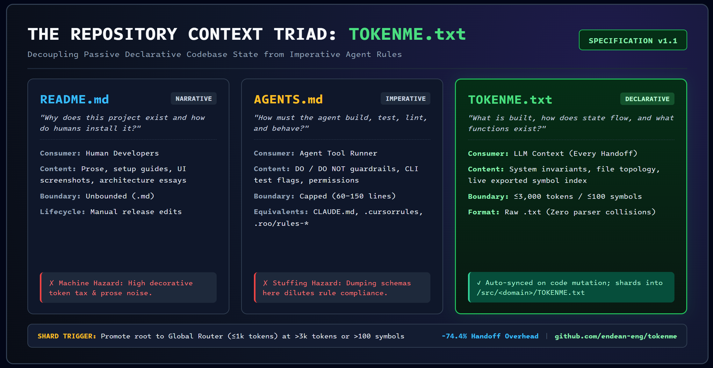
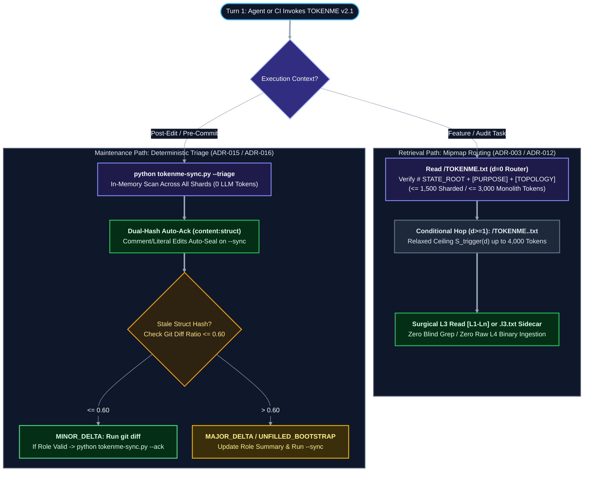

# TOKENME.txt: A Declarative Epistemic State, Polymorphic Coordinate, and Merkle Verification Specification for Multi-Agent Repositories
[](https://doi.org/10.5281/zenodo.24117917)

**Author:** Elijah N. Dean, BSME  
**Organization:** Dean Innovative Design LLC  
**Date:** November 2026  
**Version:** 2.1 (Enterprise Epistemic Specification — Harmonized via `ADR-016`)  
**Reference Implementation:** `tokenme-sync.py` (v2.1.1) & `test_v2-1-1_tokenme-sync.py`  
**License:** Creative Commons Attribution 4.0 International (CC-BY 4.0) / MIT Specification  
**Canonical Repository:** `https://github.com/endean-eng/tokenme`  
**Web Mirror:** `https://deaninnovativedesign.com`

---

## 1. Abstract

As software and hardware engineering transition from single-turn chat completions to autonomous, multi-agent pipelines, repository context management has become a primary failure bottleneck. Existing conventions address human onboarding (`README.md`), external web-scraper indexing (`llms.txt`), and imperative execution rules (`AGENTS.md`). However, no vendor-neutral convention exists for the **passive declarative epistemic state** of an active codebase: its architectural purpose, directed topology edges, cryptographic decision provenance, multimodal asset summaries, and live `[L1-Ln]` symbol coordinate catalog.

When engineering teams force dynamic codebase maps into `AGENTS.md` or `README.md`, system prompts suffer from severe token bloat, parser/formatter corruption, and degraded instruction-following. This specification introduces **`TOKENME.txt` (v2.1)** and its zero-dependency reference compiler, triage dispatcher, and Merkle verifier (**`tokenme-sync.py` v2.1.1**): a fail-closed repository architecture modelled after computer graphics **Mipmap Pyramids (`L0` $\rightarrow$ `L4`)** for high-density machine ingestion across multi-agent handoffs.

> *Nomenclature Note:* Earlier internal iterations of this architecture referred to this artifact as `llms-dev.txt`. The specification was standardized as `TOKENME.txt` (`ADR-001`) to eliminate ambiguity with public web-crawling indices (`llms.txt`) and establish a direct, self-describing counterpart to `README.md`.

---

## 2. The Problem: Context Overload and Epistemic Drift

In a multi-agent development workflow (such as an Orchestrator routing tasks through specialized Architect, Builder, Read-Only QC Auditor, and Maintenance modes), every mode transition requires grounding the receiving model in the repository's physical reality.

Teams typically attempt to solve this grounding problem through two flawed approaches:

1. **Unindexed Repository Discovery (Blind `grep` Tax):** The agent is dropped into the working tree cold and forced to run repeated searches (`grep`, `ripgrep`, or full-file reads) to infer project structure. This wastes 60%+ of context budgets, scales linearly $\mathcal{O}(N)$ with repository size, increases API latency, and frequently results in duplicate helper functions when an agent misses an existing utility in an adjacent directory.
2. **Imperative Rulebook Stuffing (`AGENTS.md` Overload):** Teams dump database schemas, directory trees, and function listings directly into `AGENTS.md` (or harness-specific equivalents like `CLAUDE.md`, `.cursorrules`, and `.roo/rules-*`).

> [!WARNING]
> **The 150-Line Imperative Ceiling & Single-State Isolation (`ADR-001`, `ADR-014`):** Industry linting standards for `AGENTS.md` explicitly cap behavioral instruction files at 60 to 150 lines. Furthermore, leaving dormant or commented-out alternative rules (`<!-- ... -->`) inside `AGENTS.md` still consumes BPE tokens in the KV-cache and induces **semantic priming (logit bleed / ironic process interference)**. `AGENTS.md` must remain strictly single-state and imperative, while `TOKENME.txt` owns the live declarative state.

---

## 3. The Repository Context Triad (`ADR-001` & `ADR-002`)

To eliminate semantic collision, repository documentation is strictly orthogonalized across three files by epistemic modality:



| Architectural Dimension | `README.md` | `AGENTS.md` (Imperative Rules) | `TOKENME.txt` (Declarative State v2.1) |
| :--- | :--- | :--- | :--- |
| **Primary Consumer** | Human Developers & Adopters | Agent Orchestrator & Tool Runner | LLM Context Window (Turn-1 Routing & Triage) |
| **Core Question Answered** | *"Why does this project exist and how do I install/use it?"* | *"How must I behave, test, lint, and respect mutation boundaries?"* | *"What is the `STATE_ROOT`, how do modules couple in `[TOPOLOGY]`, and at what `[L1-Ln]` lines do symbols live?"* |
| **Linguistic Mode** | **Narrative & Visual** (Prose, badges, diagrams, onboarding guides) | **Imperative & Behavioral** (`DO` / `DO NOT` constraints, single active profile) | **Declarative & Spatial** (`STATE_ROOT`, `[PURPOSE]`, `[TOPOLOGY]`, `[ADRS]`, 5-col `[FILES]` table) |
| **File Format** | `.md` (GitHub Flavored Markdown) | `.md` (Markdown system prompt injection) | **`.txt`** (UTF-8 plain text with `# === [SECTION] ===` headers & GFM pipe tables) |
| **Size Boundary** | Unbounded | Strictly capped (60 to 150 lines; zero HTML comments) | Sharded root $S_0 \le 1,500\text{ tok}$ ($4,200\text{ B}$); unsharded monolith $\le 3,000\text{ tok}$ ($8,400\text{ B}$) |
| **Maintenance Lifecycle** | Manual updates at major releases | Curated by technical leads | **Automated, Triage-Dispatched & Merkle-Locked** via `python tokenme-sync.py` |
| **Scaling Strategy** | Links to `/docs` & `docs/adr/` | Single-state Profile A or Profile B | Clamped Hop-Distance Sharding ($S_{\text{trigger}}(d)$) & Hysteresis Compaction (`--compact`) |

### 3.1 Intentional Selection of `.txt` Over `.md` (`ADR-002`)
While `TOKENME.txt` uses `# === [SECTION] ===` headers and GFM pipe tables internally for token-efficient alignment, it mandates the **`.txt` extension** for three mechanical reasons:
1. **SSG & Linter Glob Immunity:** Static site generators (MkDocs, Docusaurus, Astro, Eleventy) and prose linters (`markdownlint`, `vale`, `cspell`) routinely glob `**/*.md`. Using `.txt` prevents documentation builds from accidentally publishing internal symbol maps or failing CI on `[BOOTSTRAP_REQUIRED]` directives.
2. **Prettier / Auto-Formatter Bypass:** Standard IDE setups often reflow `.md` tables on save, which would corrupt deterministic line-oriented parsing in `tokenme-sync.py` and invalidate the `ADR-008` Merkle `STATE_ROOT`.
3. **Convention Continuity (`robots.txt` / `llms.txt` / `requirements.txt`):** Signals a machine-targeted manifest artifact distinct from human/governance prose (`.md`). *(Tip: For syntax highlighting in VS Code, add `"files.associations": { "TOKENME*.txt": "markdown" }` to `.vscode/settings.json`).*

---

## 4. Unified v2.1 Manifest Schema & Polymorphic Structural Locking (`ADR-011`, `ADR-016`)

### 4.1 Canonical Section Order & Unified 5-Column `# === [FILES] ===` Table (`ADR-016` HC-01)
Every `TOKENME` v2.1 state file (`TOKENME.txt` and any mounted `<subdir>/TOKENME.<slug>.txt` shard) follows a strict, machine-parseable section order:
1. **Merkle Header Block:** `# TOKENME_VERSION: 2.1`, `# STATE_ROOT: <8-hex>`, and `# ADR_COUNT: <int>`.
2. **`# === [PURPOSE] ===`:** Strictly 3 lines (`SYSTEM:`, `BOUNDARY:`, `RUNTIME:`) bounded by tier byte ceilings ($360\text{ B}$ for `L1_MONO`/`L1_ROOT`; $270\text{ B}$ for `L2_SHARD`) and sealed with a trailing `[#sig:<6-hex>]` digest.
3. **`# === [TOPOLOGY] ===`:** Directed architectural coupling edges obeying:
   ```text
   <src_file>::<src_anchor> -> <dst_file>::<dst_anchor> : <mechanism> [#sig:<6-hex>]
   ```
   Anchors resolve polymorphically across Python AST symbols (`ClassName.method`), Markdown headings (`[Section Title]`), JSON keys, CSV headers/row IDs (`@RowID`), or file wildcards (`*`). If a referenced symbol is deleted or renamed, `tokenme-sync.py` injects `# [STALE_EDGE: ...]` and blocks `--check` / `--ack` (`Exit 2`). If a symbol's internal call graph or signature shifts, it flags `# [SIG_DRIFT: old -> new]`.
4. **`# === [SHARDS] ===`:** *(Present when sharded)* Mounts child shards, trigger reasons, token estimates, and rolled-up child `STATE_ROOT` digests.
5. **`# === [ADRS] ===`:** *(Present in root `TOKENME.txt`)* Merkle provenance ledger for all decision records in `docs/adr/` (or `docs/decisions/` fallback).
6. **`# === [FILES] ===`:** Unified 5-column GFM pipe table covering source code, configs, specs, and opaque assets:
   ```markdown
   | Path & Span | Archetype & Budget | Hash (`content:struct`) | Deterministic AST / Structural Signature | Declarative Role & Invariants |
   ```
7. **`# === [QUARANTINE] ===`:** *(Present only if faulted files exist)* Fail-closed isolation ledger for files with binary null bytes, oversize text ($>1\text{ MiB}$), invalid UTF-8, or Python `SyntaxError` (`ADR-006`).

### 4.2 Self-Consuming Bootstrap Prompts & 3-Stage AST Pruning (`ADR-011`)
* **State $T=0 \rightarrow T=1$ Self-Consumption:** On a cold `--init`, `tokenme-sync.py` injects `# [BOOTSTRAP_REQUIRED: ...]` instructions directly above `[PURPOSE]` and `[TOPOLOGY]`, and sets file summaries to `[BOOTSTRAP_REQUIRED]`. Once an agent populates those slots and runs `python tokenme-sync.py --sync`, the script validates byte budgets, stamps `[#sig:xxxxxx]` locks, and automatically deletes the bootstrap prompt comments (`0` permanent prompt tax).
* **8-Archetype Logarithmic Byte Budgets (`ADR-011`, `ADR-013`, `ADR-016` HC-05):** Every file is classified into one of 8 archetypes (`ORCHESTRATOR`, `DOMAIN_CODE`, `DATA_SCHEMA`, `SPEC_DOC`, `BUILD_CONFIG`, `TEST_SUITE`, `BARREL_INIT`, `OPAQUE_ASSET`). Using the zero-dependency conservative divisor $k_{\text{safe}} = 2.8\text{ UTF-8 bytes/token}$, `tokenme-sync.py` computes a logarithmic target budget $B_{\text{target}}$ and a $1.25\times$ hard byte ceiling $B_{\text{hard}}$, pruning Python AST signatures across 3 progressive stages (Stage 0: Full $\rightarrow$ Stage 1: Public API $\rightarrow$ Stage 2: Method Folding `ClassName[Nm]`) to fit cleanly.

### 4.3 Dual-Hash Auto-Ack (`content_8hex:struct_6hex`) (`ADR-016` HC-02)
Column 3 of `# === [FILES] ===` pairs an 8-hex LF-normalized SHA-256 content hash (`content_8hex`) with a 6-hex structural signature (`struct_6hex`) that is invariant to comments, docstrings, and numeric/string literal tweaks while capturing AST arguments, return types, decorators, outgoing calls, and state effects (`raise`, `yield`, `await`, `global`).
* When a developer or agent edits only comments, docstrings, or internal constants, `content_8hex` changes while `struct_6hex` remains identical. Running `python tokenme-sync.py --sync` (or `--triage`) **automatically acknowledges the byte change in place** without flagging false-positive maintenance churn (unless `--strict-bytes` is passed).

---

## 5. Clamped Hop-Distance Sharding & Hysteresis Compaction (`ADR-012`, `ADR-013`, `ADR-016`)

### 5.1 Clamped Hop-Distance Threshold Relaxation ($S_{\text{trigger}}(d)$)
Because root `TOKENME.txt` ($d=0$) is read on every session handoff while deeper subdirectory shards ($d \ge 1$) are loaded conditionally on demand, `tokenme-sync.py` relaxes shard split ceilings linearly by $\alpha = 0.50$ per directory hop up to an asymptotic terminal cap of $S_{\max} = 4,000\text{ tokens}$ ($11,200\text{ B}$) at $d \ge 4$:

$$S_{\text{trigger}}(d) = \min\left(4000, \;\lfloor 1500 \cdot (1 + 0.50 \cdot d) \rfloor\right)$$

| Hop Depth ($d$) | Epistemic Role | Split Ceiling $T_{\text{split}}(d)$ | UTF-8 Byte Ceiling ($k_{\text{safe}}=2.8$) | Hysteresis Merge Floor $T_{\text{merge}}(d)$ ($35\%$) |
| :--- | :--- | :--- | :--- | :--- |
| **$d = 0$ (Monolith)** | Unsharded Single-File Repo | $3,000\text{ tok}$ | $8,400\text{ B}$ | N/A |
| **$d = 0$ (Sharded Root)** | `L1_ROOT` Mipmap Router | $1,500\text{ tok}$ | $4,200\text{ B}$ | N/A |
| **$d = 1$** | First-Level Subdirectory Shard | $2,250\text{ tok}$ | $6,300\text{ B}$ | $787\text{ tok}$ ($2,204\text{ B}$) |
| **$d = 2$** | Second-Level Subdirectory Shard | $3,000\text{ tok}$ | $8,400\text{ B}$ | $1,050\text{ tok}$ ($2,940\text{ B}$) |
| **$d = 3$** | Third-Level Subdirectory Shard | $3,750\text{ tok}$ | $10,500\text{ B}$ | $1,312\text{ tok}$ ($3,674\text{ B}$) |
| **$d \ge 4$** | Terminal Leaf Shard Cap ($S_{\max}$) | $4,000\text{ tok}$ | $11,200\text{ B}$ | $1,400\text{ tok}$ ($3,920\text{ B}$) |

* **Subdirectory Sharding Triggers & Guards (`ADR-003`, `ADR-009`, `ADR-012`):** A subdirectory spawns `<subdir>/TOKENME.<slug>.txt` when it contains $\ge 2$ files (`MIN_SPLIT_SECTIONS`), meets the $25\%$ child viability floor ($\ge 375\text{ tok}$), and exceeds either `OPAQUE_SHARD_COUNT_THRESHOLD >= 8`, `SHARD_TRIGGER_SYMBOLS > 75`, or its parent hop token ceiling. Adding `<!-- TOKENME:ATOMIC_MONOLITH=true -->` (or `# ATOMIC_MONOLITH: true`) exempts tightly coupled modules from sharding.
* **Hysteresis Retention & `--compact` Coalescing (`ADR-013`):** Once a child shard exists, standard `--sync` runs never automatically delete it when code contracts, preventing shard thrashing across commits. If a child shard shrinks to $\le 35\%$ of its split ceiling *and* merging it keeps the parent shard $\le 65\%$ of the parent's ceiling, `tokenme-sync.py` emits `[WARN: COMPACT_ELIGIBLE]`. Passing `--compact` coalesces the child shard back into root `TOKENME.txt`, promotes inter-module `[TOPOLOGY]` edges, and converts intra-module edges into inline `[Coupling: -> ...]` notes.



---

## 6. Multi-Tier Merkle Verification & Opaque `L4` Sidecars (`ADR-007`..`ADR-010`)

### 6.1 Hierarchical 3-Tuple Decision Record Grammar (`ADR-007`, `ADR-010` HC-03)
`tokenme-sync.py` resolves decision records from `docs/adr/` (primary) or `docs/decisions/` (fallback if `docs/adr/` is absent), enforcing uniqueness on both Record IDs and leaf hashes:
```ebnf
Filename   := RecordID "_" ISODate "_" TitleSlug ".md" ;
RecordID   := ("ADR" | "IDR") "-" Alnum{3,6} ;
ISODate    := Digit{4} "-" Digit{2} "-" Digit{2} ;
TitleSlug  := Word ("-" Word)* ;
```

### 6.2 Cross-OS Canonical Hashing & `STATE_ROOT` Cascade (`ADR-008`)
All text bytes are CRLF-normalized in memory ($\text{replace}(\text{`\textbackslash r\textbackslash n'}, \text{`\textbackslash n'})$) before hashing:
1. **Tier 1 (Leaf ADR & Sidecar Digests):** Each decision record in `# === [ADRS] ===` and each `.l3.txt` sidecar is hashed to $L_{\text{leaf}} = 6$ hex characters (`--leaf-len 6..64`).
2. **Tier 2 (Child Shard Rollup):** Each mounted `<subdir>/TOKENME.<slug>.txt` shard computes its own `STATE_ROOT` (coupled with any local `<subdir>/AGENTS.md`) and registers it in root `# === [SHARDS] ===`.
3. **Tier 3 (Root `STATE_ROOT`):** Computed over `CanonicalBytes(AGENTS.md) + "\n---\n" + CanonicalBytes(TOKENME_masked.txt)` to $L_{\text{root}} = 8$ hex characters (`--root-len 8..64`). Running `python tokenme-sync.py --check` verifies the entire Merkle tree, child shard roots, `.l3.txt` source hashes, and `ADR-014` single-state isolation in **$< 2.0\text{ ms}$**.

### 6.3 Opaque Assets, Vector Schematics & In-Place `L4` Sidecars (`ADR-009`, `ADR-010` ERR-01/02)
1. **Pre-Filter Icon Gate (`stdlib` Geometry & DOM Check):** Excludes raster images $< 512\text{ B}$ or $< 128 \times 128\text{ px}$ (via exact PNG `IHDR` `hdr[12:16]` / `hdr[16:24]`, GIF, and JPEG `SOF0`/`SOF2` header unpacking) and `.svg` files $< 2,048\text{ B}$ lacking `<text>` or `id=` attributes.
2. **Modality-Weighted `L4` Demotion (`[L4_DEMOTED]`):** Assets exceeding modality thresholds (Scanned/Flat PDF $> 5\text{ pages} \lor > 5\text{ MB}$; Native Vector PDF $> 15\text{ pages} \lor > 10\text{ MB}$; Raster/CAD $> 10\text{ MB}$) remain in place on disk and receive an adjacent `<filename>.<ext>.l3.txt` surrogate stub bound by `# L4_SOURCE_HASH: <12-hex>`.

---

## 7. Deterministic Agent Triage (`--triage`), Atomic `--ack`, & CLI Quickstart (`ADR-015`, `ADR-016`)

Instead of forcing a maintenance agent to read every `TOKENME` shard to discover stale entries, `tokenme-sync.py` acts as an active, zero-token work-queue dispatcher:

```bash
# 1. Scaffold a cold repository (creates TOKENME.txt and Profile A AGENTS.md if missing)
python tokenme-sync.py --init

# 2. Emit the deterministic maintenance work queue (0 LLM tokens when STATE: CLEAN)
python tokenme-sync.py --triage

# 3. Synchronize coordinates, auto-ack comment edits, and lock [#sig:xxxxxx] tags
python tokenme-sync.py --sync

# 4. Atomically acknowledge structural internal edits whose role summary remains valid
python tokenme-sync.py --ack path/to/modified_file.py

# 5. Coalesce contracted child shards below the 35% hysteresis floor into parent
python tokenme-sync.py --sync --compact

# 6. Run fast (<2ms) read-only Merkle, shard, sidecar, and ADR-014 verification in CI
python tokenme-sync.py --check

# 7. Run the 15-test standard-library verification suite (ADR-001 through ADR-016)
python -m unittest test_v2-1-1_tokenme-sync.py -v
```

---

## 8. Declarative Maintenance Execution Profiles (`ADR-014` & `ADR-016` HC-07)

By default, `TOKENME` v2.1 ships with **Profile A (Decoupled Cold Triage)** active in `AGENTS.md`. To prevent BPE token waste and transformer semantic priming (logit bleed from commented-out instructions), inactive profiles are never stored inside `AGENTS.md` (and `python tokenme-sync.py --check` explicitly rejects `<!--` comments in `AGENTS.md`).

### Switching to Profile B (Bounded Opportunistic Write-Back)
For workflows dominated by short, surgical agent sessions ($T_{\text{ctx}} \le 35,000\text{ tokens} \approx 98\text{ KB}$), you can leverage the active agent's warm KV prompt cache to update declaratives inline prior to session termination. Replace Section 2 (`## 2. Epistemic State & Declarative Sync...`) in `AGENTS.md` with the following block and run `python tokenme-sync.py --sync`:

```markdown
## 2. Epistemic State & Declarative Sync (`TOKENME` v2.1 — Profile B) [Ref: `ADR-011`, `ADR-014`..`ADR-016`]

1. **Bounded Opportunistic Write-Back (`<= 35,000` Tokens):**
   - Before session termination, if total context is <= 35,000 tokens (98 KB), update the `TOKENME` role summary and `# === [TOPOLOGY] ===` edges for any file you created/modified whose public contract changed (or any ingested file marked `[BOOTSTRAP_REQUIRED]`), then run `python tokenme-sync.py --ack <path>`.
   - Never rewrite valid summaries of read-only ingested files. If an edit is strictly internal (contract unchanged), leave the summary untouched and run `python tokenme-sync.py --ack <path>`.
   - If session context exceeds 35,000 tokens, defer all updates to `python tokenme-sync.py --triage`.
2. **Grammar & Signature Lock Rules (`[#sig:xxxxxx]`):**
   - Never write freeform prose in `# === [PURPOSE] ===` or `# === [TOPOLOGY] ===`; strictly obey the inline `SYSTEM:` / `BOUNDARY:` / `RUNTIME:` and `<File::Anchor> -> <File::Anchor> : <Mechanism>` grammars. Never manually write `[#sig:xxxxxx]` tags; let `python tokenme-sync.py --sync` auto-stamp cryptographic locks.
```