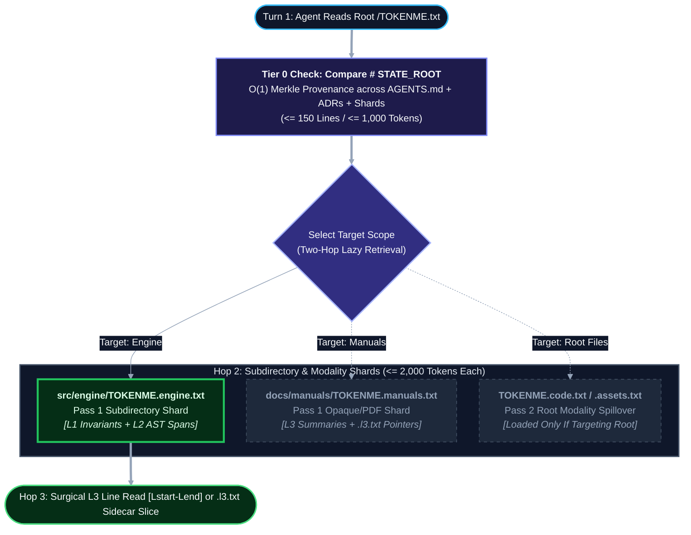

# TOKENME.txt: A Declarative Epistemic State, Symbol Coordinate, and Merkle Verification Specification for Multi-Agent Repositories
[](https://doi.org/10.5281/zenodo.24117917)

**Author:** Elijah N. Dean, BSME  
**Organization:** Dean Innovative Design LLC  
**Date:** November 2026  
**Version:** 2.0 (Enterprise Epistemic Specification)  
**License:** Creative Commons Attribution 4.0 International (CC-BY 4.0) / MIT Specification  
**Canonical Repository:** `https://github.com/endean-eng/tokenme`  
**Web Mirror:** `https://deaninnovativedesign.com`

---

## 1. Abstract

As software and hardware engineering transition from single-turn chat completions to autonomous, multi-agent pipelines, repository context management has become a primary failure bottleneck. Existing conventions address human onboarding (`README.md`), external web-scraper indexing (`llms.txt`), and imperative execution rules (`AGENTS.md`). However, no vendor-neutral convention exists for the **passive declarative epistemic state** of an active codebase: its architectural invariants, cryptographic decision provenance, multimodal asset summaries, and live `[Lstart-Lend]` symbol coordinate catalog.

When engineering teams force dynamic codebase maps into `AGENTS.md` or `README.md`, system prompts suffer from severe token bloat, parser/formatter corruption, and degraded instruction-following. This specification introduces **`TOKENME.txt` (v2.0)** and its zero-dependency reference synchronizer (**`tokenme-sync.py`**): a fail-closed, Merkle-verified repository architecture modelled after computer graphics **Mipmap Pyramids (`L0` $\rightarrow$ `L4`)** for high-density machine ingestion across multi-agent handoffs.

---

## 2. The Problem: Context Overload and Epistemic Drift

In a multi-agent development workflow (such as an Orchestrator routing tasks through specialized Architect, Builder, and Read-Only QC Auditor modes), every mode transition requires grounding the receiving model in the repository's physical reality.

Teams typically attempt to solve this grounding problem through two flawed approaches:

1. **Unindexed Repository Discovery (Blind `grep` Tax):** The agent is dropped into the working tree cold and forced to run repeated searches (`grep`, `ripgrep`, or full-file reads) to infer project structure. This wastes 60%+ of context budgets, increases API latency, and frequently results in duplicate helper functions when an agent misses an existing utility in an adjacent directory.
2. **Imperative Rulebook Stuffing (`AGENTS.md` Overload):** Teams dump database schemas, directory trees, and function listings directly into `AGENTS.md` (or harness-specific equivalents like `CLAUDE.md`, `.cursorrules`, and `.roo/rules-*`).

> [!WARNING]
> **The 150-Line Imperative Ceiling:** Industry linting standards for `AGENTS.md` explicitly cap behavioral instruction files at 60 to 150 lines. When imperative behavioral rules (*how the agent must act*) are diluted inside thousands of lines of declarative codebase state (*what exists and where it lives*), attention mechanisms degrade and agents violate core build and safety constraints.

---

## 3. The Repository Context Triad (`ADR-001` & `ADR-002`)

To eliminate semantic collision, repository documentation is strictly orthogonalized across three files by epistemic modality:

| Architectural Dimension | `README.md` | `AGENTS.md` (Imperative Rules) | `TOKENME.txt` (Declarative State) |
| :--- | :--- | :--- | :--- |
| **Primary Consumer** | Human Developers & Adopters | Agent Orchestrator & Tool Runner | LLM Context Window (Every Turn-1 Handoff) |
| **Core Question Answered** | *"Why does this project exist and how do I install/use it?"* | *"How must I behave, test, lint, and respect mutation boundaries?"* | *"What exists, what is the `STATE_ROOT`, and at what `[Lstart-Lend]` lines do symbols live?"* |
| **Linguistic Mode** | **Narrative & Visual** (Prose, badges, diagrams, onboarding guides) | **Imperative & Behavioral** (`DO` / `DO NOT` constraints, CLI flags, permissions) | **Declarative & Spatial** (`STATE_ROOT`, ADR leaf hashes, `L1` invariants, `L2` `[Lstart-Lend]` spans) |
| **File Format** | `.md` (GitHub Flavored Markdown) | `.md` (Markdown system prompt injection) | **`.txt`** (UTF-8 plain text with lightweight internal tables & YAML footer) |
| **Size Boundary** | Unbounded | Strictly capped (60 to 150 lines) | Root router $\le 150$ lines ($\le 1,000$ tokens); child shards $\le 2,000$ tokens |
| **Maintenance Lifecycle** | Manual updates at major releases | Curated by technical leads | **Automated & Merkle-Locked** via `python3 tokenme-sync.py` |
| **Scaling Strategy** | Links to `/docs` & `docs/adr/` | Role- or directory-scoped rules | Two-Pass Mipmap Sharding (`<subdir>/TOKENME.<subsystem>.txt` & root modality ejection) |

### 3.1 Intentional Selection of `.txt` Over `.md` (`ADR-002`)
While `TOKENME.txt` uses lightweight Markdown headers and pipe tables internally for token-efficient visual alignment, it mandates the **`.txt` extension** for three mechanical reasons:
1. **SSG & Linter Glob Immunity:** Static site generators (MkDocs, Docusaurus, Astro) and prose linters (`markdownlint`, `vale`, `cspell`) routinely glob `**/*.md`. Using `.txt` prevents documentation builds from accidentally publishing internal symbol maps or failing CI on `[TODO: AGENT_FILL]` directives.
2. **Prettier / Auto-Formatter Bypass:** Standard IDE setups often reflow `.md` tables on save, which would corrupt deterministic line-oriented parsing in `tokenme-sync.py` and invalidate the `ADR-008` Merkle `STATE_ROOT`.
3. **Convention Continuity (`robots.txt` / `llms.txt` / `requirements.txt`):** Signals a machine-targeted manifest artifact distinct from human/governance prose (`.md`).

### 3.2 Repeated Per-Handoff Economics
In a multi-stage agentic pipeline with $H$ handoffs (e.g., *Plan $\rightarrow$ Implement $\rightarrow$ Audit $\rightarrow$ Archive*, $H \ge 4$), the cumulative token cost $C_{\text{total}}$ is:

$$C_{\text{total}} = \sum_{i=1}^{H} \left( T_{\text{system}, i} + T_{\text{TOKENME}} + T_{\text{ephemeral}, i} \right)$$

Because $T_{\text{TOKENME}}$ is paid on every handoff $H$, bounding the root `TOKENME.txt` router to $\le 1,000$ tokens ($\le 150$ lines) and enabling 1-based `[Lstart-Lend]` surgical slicing (`start_line` / `end_line`) compresses cold-start exploration by **10x to 100x+**.

---

## 4. The Mipmap Resolution Pyramid & Two-Pass Sharding (`ADR-003`, `ADR-004`, `ADR-009`, `ADR-010`)

### 4.1 Five Resolution Tiers (`L0` $\rightarrow$ `L4`)
`TOKENME` v2.0 models repository context after computer graphics **Mipmap Pyramids**:
* **`L0` (System Identity, Merkle `STATE_ROOT` & Global Invariants):** Root `TOKENME.txt` header, runtime manifest fingerprint, and the `docs/adr/` Merkle provenance table ($\le 1,000$ tokens / $\le 150$ lines when sharded).
* **`L1` (File Inventory, Shard Mounts & Role Invariants):** File-level responsibility and mutation boundaries.
* **`L2` (Symbol Coordinate & Opaque Asset Digest):** Granular class/function `[Lstart-Lend]` spans (`def ClassName.method_name [L12-L88]`), cross-shard `-> impl:` pointers, and 3-line `L3` opaque asset summaries ($\le 2,000$ tokens per shard).
* **`L3` (Raw Source Code & `.l3.txt` Surrogate Sidecars):** Surgical line-range reads executed on demand by the agent, or co-located `<filename>.<ext>.l3.txt` text surrogates for heavy `L4` binaries.
* **`L4` (In-Place Cold Binary Storage):** Multi-page PDFs and heavy CAD/raster assets (`[L4_DEMOTED]`) that remain in place on disk and are never ingested whole into LLM context.

### 4.2 Deterministic Two-Pass Sharding Protocol (`ADR-009` Part E & `ADR-010` HC-02)
To guarantee that root `TOKENME.txt` never breaches its **$\le 150$-line ($\sim 1,000$-token) ceiling**—even in repositories with bulk inspection photos or flat root directories—`tokenme-sync.py` executes a two-pass sharding algorithm:

| Pass & Trigger | Threshold Constant | Resulting Shard Artifact | Engineering Rationale |
| :--- | :--- | :--- | :--- |
| **Pass 1: Subdirectory Symbol Count** | `SHARD_TRIGGER_SYMBOLS > 75` | `<subdir>/TOKENME.<subsystem>.txt` | Co-locates domain `L1` file invariants with `L2` function spans inside the target directory while avoiding IDE tab collisions with root `TOKENME.txt`. |
| **Pass 1: Opaque Asset Density** | `OPAQUE_SHARD_COUNT_THRESHOLD >= 8` | `<subdir>/TOKENME.<subsystem>.txt` | Prevents image/schematic folders (zero AST symbols) from overflowing the parent index. |
| **Pass 1: Projected L2 Footprint** | $L_{\text{code}} + 5 N_{\text{opaque}} > 100\text{ lines}$ | `<subdir>/TOKENME.<subsystem>.txt` | Accounts for 5-line hydrated opaque blocks alongside source symbols. |
| **Pass 2: Single Root Spillover** | Root $> 150$ lines & ejected $\le 250$ lines | `TOKENME.root-l2.txt` | Ejects unsharded root `L2` entries into a single co-located shard to minimize agent hop count. |
| **Pass 2: Heavy Modality Split** | Root $> 150$ lines & ejected $> 250$ lines | `TOKENME.code.txt` + `TOKENME.assets.txt` | Partitions heavy unsharded root entries by modality while maintaining a strict 1-to-1 Merkle tree (no duplication of Pass 1 files). |



---

## 5. Multi-Tier Merkle Epistemic State Verification (`ADR-007` & `ADR-008`)

### 5.1 Hierarchical 3-Tuple Decision Record Grammar (`ADR-007` & `ADR-010` HC-04)
Architecture Decision Records in `docs/adr/` (and gitignored internal strategy records in `.roo/decisions-internal/`) follow a deterministic two-delimiter ASCII filename grammar that decomposes in $O(1)$ via `stem.split("_")`:

```ebnf
Filename   := RecordID "_" ISODate "_" TitleSlug ".md" ;
RecordID   := ("ADR" | "IDR") "-" Alnum{3,6} ;
ISODate    := Digit{4} "-" Digit{2} "-" Digit{2} ;
TitleSlug  := Word ("-" Word)* ;
```

*(Note: External repositories adopting `TOKENME.txt` are not required to rename legacy ADRs; `tokenme-sync.py` treats this grammar as advisory for external repos while enforcing it within `endean-eng/tokenme`).*

### 5.2 Cross-OS Canonical Hashing & `STATE_ROOT` Cascade (`ADR-008`)
To prevent Windows CRLF (`\r\n`) vs. Linux/macOS LF (`\n`) divergence under `git checkout`, `tokenme-sync.py` normalizes all text bytes in memory before hashing:

$$\text{CanonicalBytes}(F) = \text{strip}\left(\text{replace}(\text{read\_bytes}(F), \text{`\textbackslash r\textbackslash n'}, \text{`\textbackslash n'})\right)$$

1. **Tier 1 (Leaf ADR & Sidecar Digests):** Each decision record $F_i \in \text{docs/adr/*.md}$ (and each `.l3.txt` sidecar) is hashed to a configurable hex digest $H_{\text{leaf}, i} = \text{SHA256}(\text{CanonicalBytes}(F_i))_{[0:L_{\text{leaf}}]}$ (default $L_{\text{leaf}} = 6$, configurable `6..64` via `--leaf-len`) and recorded in `TOKENME.txt`.
2. **Tier 2 (Child Shard Rollup):** Each mounted `<subdir>/TOKENME.<subsystem>.txt` shard computes its own `STATE_ROOT` bottom-up and registers it in the root `TOKENME.txt` Shard Router Table.
3. **Tier 3 (Root `STATE_ROOT`):** Computed over the concatenation of normalized `AGENTS.md` and `TOKENME.txt` (with the `# STATE_ROOT:` value masked as `MASKED_STATE_ROOT`), truncated to $L_{\text{root}}$ hex chars (default `8`, configurable `8..64` via `--root-len`):

$$H_{\text{root}} = \text{SHA256}\left(\text{CanonicalBytes}(\text{AGENTS.md}) \;\Vert\; \text{`\textbackslash n---\textbackslash n'} \;\Vert\; \text{CanonicalBytes}(\text{TOKENME}_{\text{masked}}\text{.txt})\right)_{[0:L_{\text{root}}]}$$

Running `python3 tokenme-sync.py --check` in pre-commit or CI verifies the entire Merkle tree in **$< 2.0\text{ ms}$**.

---

## 6. Opaque Assets, Vector Schematics, and In-Place `L4` Sidecars (`ADR-009`)

In multi-disciplinary software and hardware repositories, critical engineering specifications often reside inside wiring schematics (`.svg`, `.png`), equipment nameplate photos (`.jpg`), and multi-page service manuals (`.pdf`). `TOKENME` v2.0 governs non-code assets through three rules:

1. **Pre-Filter Icon Gate (`stdlib` Geometry & DOM Check):** Trivial UI icons are excluded automatically (raster images $< 512\text{ B}$ or $< 128 \times 128\text{ px}$; `.svg` files $< 2,048\text{ B}$ with zero `<text>` or `id=` attributes). Qualifying `.svg` diagrams are never dumped into context as raw XML `<path>` soup; `tokenme-sync.py` scrapes `<title>`, `<desc>`, `<text>`, and `<g id="...">` strings while the hydrating agent inspects a rendered raster view.
2. **Modality-Weighted Inclusive `OR` ($\lor$) `L4` Demotion:** Heavy assets breaching any modality ceiling are logically demoted to **`L4` (`[L4_DEMOTED]`)** *in place on disk* (never breaking relative paths):
   * **Scanned / Flat PDF (`< 50` chars/page):** $\text{Pages} > 5 \;\lor\; \text{Bytes} > 5\text{ MB}$
   * **Native Vector PDF (`>= 50` chars/page):** $\text{Pages} > 15 \;\lor\; \text{Bytes} > 10\text{ MB}$
   * **High-Res Raster / CAD:** $\text{Bytes} > 10\text{ MB}$
3. **Co-Located `.l3.txt` Surrogate Sidecar & Coupled Merkle Hash:** Every `L4`-demoted asset receives an adjacent `<filename>.<ext>.l3.txt` file containing `# L4_SOURCE_HASH: <streaming_sha256>` on Line 3, deterministic pre-scraped metadata, and agent-hydrated `Page_Map_And_TOC` + `Key_Specs_And_OCR` sections. Hashing `.l3.txt` into `TOKENME.txt` cryptographically binds both the raw `L4` binary and its `L3` semantic summary.

---

## 7. Reference CLI Synchronizer: `tokenme-sync.py` (`ADR-005`, `ADR-006`, `ADR-010`)

To guarantee 100% cold-start portability across Windows, macOS, and Linux without C-compiler wheels or virtual environment friction, **`tokenme-sync.py`** uses **only the Python $\ge 3.9$ standard library** (`ast`, `hashlib`, `pathlib`, `struct`, `re`, `tempfile`).

* **Exact AST Where Native, Honest Structural Stubs Elsewhere (`ADR-006` Invariant 2):** Extracts exact class/method coordinates (`def ClassName.method_name [Lstart-Lend]`) and `__init__.py` exports for Python via `ast.parse()`. Non-Python source files receive deterministic token budgets and `[AGENT_POPULATE_SYMBOLS]` stubs (avoiding the $>85\%$ hallucination rate of polyglot regex scrapers), which `tokenme-sync.py` preserves across subsequent syncs.
* **Fail-Closed Traversal & Atomic Writes (`ADR-006` Invariants 3–4):** Ignores directory/external symlinks, isolates `UnicodeDecodeError` and `SyntaxError` faults per file (`[UNPARSEABLE: <Reason>]`), and stages all shard writes in temporary files before committing via atomic `os.replace()`.

### Quickstart CLI Commands
```bash
# 1. Scaffold a cold repository for the first time
python3 tokenme-sync.py --init

# 2. Synchronize AST coordinates, .l3.txt sidecars, and Merkle STATE_ROOT after edits (default)
python3 tokenme-sync.py

# 3. Run fast (<2ms) read-only Merkle & ADR integrity verification in pre-commit or CI
python3 tokenme-sync.py --check
```