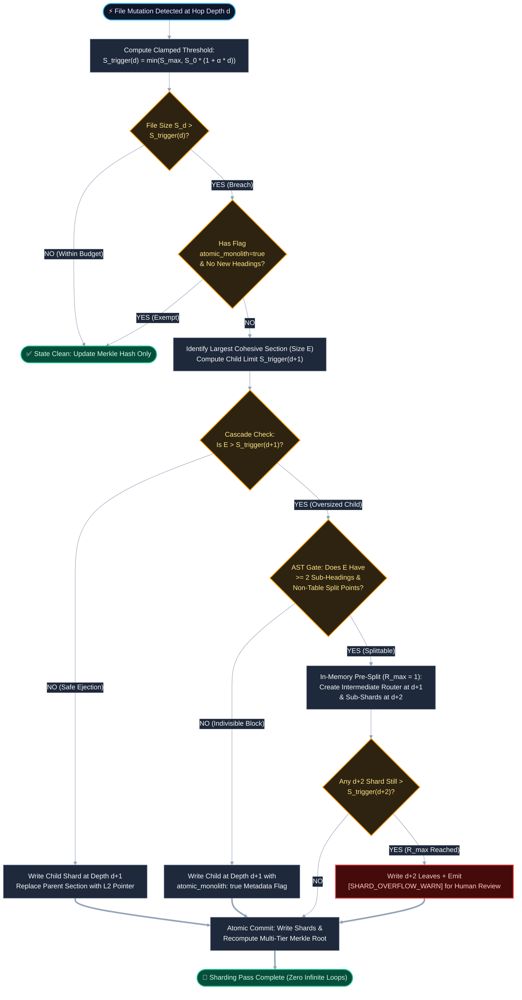

# ADR-012:2026-11-13:Clamped Hop-Distance Threshold Relaxation & Cascade Sharding Guards

**Filename:** `ADR-012_2026-11-13_Clamped-Hop-Distance-Sharding-And-Cascade-Guards.md`  
**Status:** `PROPOSED`  
**Date:** `2026-11-13`  
**Scope:** `TOKENME` v2.0 Specification & `tokenme-sync.py` Deterministic Scaffolder

---

## 1. Context & Problem Statement

Under earlier `TOKENME` iterations (ADR-001, ADR-011), sharding triggers were evaluated either uniformly across the hierarchy or solely by static file archetype. In practice, two structural pathologies emerge as repositories scale:

1. **Over-Fragmentation at Deep Leaves (The Hop-Distance Tax):**  
   A node at topological hop depth $d$ from the root `TOKENME.txt` ($d=0$) has a decaying probability of being loaded into an agent's active context window during a given session, $P(\text{load} \mid d) \approx \gamma^d$. Enforcing a rigid, low token ceiling at $d \ge 2$ forces premature sharding of cohesive deep-leaf specifications, multiplying file-pointer overhead and directory clutter for files that rarely tax baseline context. Conversely, relaxing the threshold *unconditionally* risks **Conditional Peak Context Starvation**: when an agent *does* traverse to depth $d=3$ to debug a subsystem, $P(\text{load} \mid 3) = 1.0$ for that turn, and an unbounded leaf floods the working context window alongside its ancestor chain ($d=0 \to 1 \to 2$).
2. **Unprotected Cascade Sharding (Oversized Ejected Shards):**  
   Repository documentation and state growth are heavily skewed toward active subsystems ($70\text{--}85\%$ of parent growth often resides in a single section). When a parent node at depth $d$ breaches its sharding threshold and ejects its largest cohesive section of size $E$ into a new child shard at depth $d+1$, $E$ frequently exceeds the child's trigger threshold immediately upon creation. Without deterministic cascade guards, this causes either infinite split loops in watcher-driven pipelines, unhandled exceptions on indivisible blocks (e.g., giant Markdown tables or schemas), or silent invariant violations on disk.

---

## 2. Decision Drivers & Mathematical Model

### 2.1 Expected Session Cost vs. Conditional Peak Cost

The expected per-session token cost of a node of token weight $S_d$ at hop depth $d$ is:

$$E[\text{Tokens}_d] = P(\text{load} \mid d) \cdot S_d$$

While expected session cost decays with depth $d$, the **conditional peak turn cost** along an active traversal path of depth $D$ is cumulative:

$$\text{PeakContext}(D) = \sum_{i=0}^{D} S_i$$

To minimize index-hopping overhead at deeper tiers while strictly bounding $\text{PeakContext}(D)$ and preserving LLM line-edit reliability, the sharding trigger threshold $S_{\text{trigger}}(d)$ MUST scale linearly with hop depth $d$ up to a hard asymptotic ceiling $S_{\max}$.

### 2.2 The Clamped Linear Hop-Relaxation Formula

For any `TOKENME` shard or managed context node at hop distance $d \in \mathbb{N}_0$ from the repository root `TOKENME.txt` ($d=0$), the sharding trigger threshold is governed by:

$$S_{\text{trigger}}(d) = \min\left( S_{\max},\; S_0 \cdot (1 + \alpha \cdot d) \right)$$

Where the normative v2.0 baseline constants are:

* $S_0 = 1,500\text{ tokens}$ (`~150 lines` at L1 root routing density)
* $\alpha = 0.50$ (linear hop-relaxation coefficient per topological hop)
* $S_{\max} = 4,000\text{ tokens}$ (hard asymptotic ceiling for single-turn attention retention and diff/patch reliability)

---

## 3. Normative Specification

### 3.1 Tiered Hop-Distance Threshold Matrix

| Hop Depth ($d$) | Topological Role | Trigger Formula | Normative Token Ceiling $S_{\text{trigger}}(d)$ | Approx. Line Equivalent | Operational Mandate |
| :--- | :--- | :--- | :--- | :--- | :--- |
| **$d = 0$** | Root Router (`TOKENME.txt`) | $S_0 \cdot (1 + 0)$ | **$1,500\text{ tokens}$** | `<= 150 lines` | Loaded $100\%$ of sessions. Pure L1 routing table, Merkle root, and global invariants. Zero inline prose. |
| **$d = 1$** | Modality / Domain Shard (`TOKENME.<domain>.txt`) | $S_0 \cdot (1 + 0.5)$ | **$2,250\text{ tokens}$** | `~225 lines` | Loaded on domain entry. Balances L2 subsystem pointers with domain-level boundaries. |
| **$d = 2$** | Subsystem / Module Shard | $S_0 \cdot (1 + 1.0)$ | **$3,000\text{ tokens}$** | `~300 lines` | Loaded during targeted feature or hardware subsystem work. Absorbs moderate specification growth without sub-hopping. |
| **$d = 3$** | Component / Deep Leaf Shard | $S_0 \cdot (1 + 1.5)$ | **$3,750\text{ tokens}$** | `~375 lines` | Deep technical spec, state table, or derivation. |
| **$d \ge 4$** | Terminal Leaf Node (Clamped) | $\min(4000, \dots)$ | **$4,000\text{ tokens}$ (Cap)** | `<= 400 lines` | Hard asymptotic ceiling $S_{\max}$. Prevents "Lost in the Middle" attention degradation and diff fragility. |

> [!NOTE]
> **Natural Shock Absorption Property:** Because $S_{\text{trigger}}(d+1) > S_{\text{trigger}}(d)$ for all $d < 4$, any parent file at depth $d$ that crosses $S_{\text{trigger}}(d)$ by a normal incremental margin and ejects a subset of size $E \le S_{\text{trigger}}(d)$ is **mathematically guaranteed** to satisfy $E < S_{\text{trigger}}(d+1)$. Cascade triggers can therefore only occur during large bulk ingestions where $E > S_{\text{trigger}}(d+1)$ or at depths $d \ge 3$ where the $S_{\max}$ ceiling flattens the curve.

---

### 3.2 Cascade Sharding & Oversized Ejection Guards

When a parent node at depth $d$ exceeds $S_{\text{trigger}}(d)$ and selects a cohesive candidate block of token size $E$ for ejection to depth $d+1$, the sharder (`tokenme-sync.py` scaffolder + hydrating agent) MUST enforce three deterministic guards:

1. **Guard 1 — Pre-Flight Child Threshold Audit:**  
   Before writing the ejected shard to disk at depth $d+1$, evaluate whether $E > S_{\text{trigger}}(d+1)$. If $E \le S_{\text{trigger}}(d+1)$, proceed with standard single-hop ejection.
2. **Guard 2 — AST Splitability Gate & `atomic_monolith` Exemption:**  
   If $E > S_{\text{trigger}}(d+1)$, parse the Markdown Abstract Syntax Tree (AST) of the candidate block:
   * **Indivisible Block (`< 2` child H2/H3 section boundaries, or $>80\%$ single GFM table / fenced code block / math derivation):** The block CANNOT be semantically subdivided without destroying data integrity. Eject it intact to depth $d+1$ and inject the header flag `<!-- TOKENME:ATOMIC_MONOLITH=true -->` (or frontmatter `atomic_monolith: true`). `tokenme-sync.py` MUST exempt flagged atomic monoliths from automatic sharding alerts until subsequent edits append new distinct AST heading sections.
   * **Splittable Compound Block (`>= 2` cohesive H2/H3 sub-sections):** The block is eligible for pre-split routing.
3. **Guard 3 — Single-Pass Recursion Cap ($R_{\max} = 1$):**  
   Automated sharding pipelines MUST NOT execute unbounded recursive splitting loops across multiple turns. If a candidate block is both oversized ($E > S_{\text{trigger}}(d+1)$) and AST-splittable, the sharder may perform **at most one additional in-memory pre-split** ($R_{\max} = 1$), generating an intermediate routing index at $d+1$ and leaf shards at $d+2$ within a single atomic commit. Any deeper structural overflow beyond $d+2$ MUST halt auto-sharding, write the $d+2$ leaves with a `[SHARD_OVERFLOW_WARN]` status flag in `tokenme-sync.py`, and escalate to the human operator or lead architect.

---

## 4. State Machine & Execution Topology



---

## 5. Reference Implementation (`tokenme-sync.py` Scaffolder Logic)

The deterministic scaffolder (`tokenme-sync.py`) implements hop-distance threshold calculation and AST splitability inspection using zero external dependencies:

```python
import re
from dataclasses import dataclass

# ADR-012 Normative Constants
S_0_TOKENS: int = 1500
ALPHA_HOP_COEFF: float = 0.50
S_MAX_TOKENS: int = 4000
CHARS_PER_TOKEN: int = 4  # Deterministic heuristic (1 token ~= 4 chars)

ATOMIC_FLAG_PATTERN = re.compile(
    r"(?:<!--\s*TOKENME:ATOMIC_MONOLITH=true\s*-->|^atomic_monolith:\s*true\b)",
    re.IGNORECASE | re.MULTILINE,
)
HEADING_SPLIT_PATTERN = re.compile(r"^#{2,3}\s+.+$", re.MULTILINE)


@dataclass(frozen=True)
class ShardEvaluation:
    hop_depth: int
    estimated_tokens: int
    trigger_threshold: int
    is_breached: bool
    is_atomic_monolith: bool
    ast_split_count: int
    recommended_action: str


def compute_shard_trigger(hop_depth: int) -> int:
    """Computes S_trigger(d) = min(S_max, S_0 * (1 + alpha * d))."""
    if hop_depth < 0:
        raise ValueError("hop_depth must be non-negative")
    raw_limit = int(S_0_TOKENS * (1.0 + ALPHA_HOP_COEFF * hop_depth))
    return min(S_MAX_TOKENS, raw_limit)


def evaluate_node_sharding(content: str, hop_depth: int) -> ShardEvaluation:
    """Evaluates a file or candidate shard block against ADR-012 guards."""
    est_tokens = max(1, len(content) // CHARS_PER_TOKEN)
    trigger = compute_shard_trigger(hop_depth)
    is_atomic = bool(ATOMIC_FLAG_PATTERN.search(content))

    # Strip fenced code blocks before counting structural markdown headings
    stripped_code = re.sub(r"```[\s\S]*?```", "", content)
    headings = HEADING_SPLIT_PATTERN.findall(stripped_code)
    split_count = len(headings)

    if est_tokens <= trigger:
        action = "OK"
    elif is_atomic and split_count < 2:
        action = "EXEMPT_ATOMIC_MONOLITH"
    elif split_count < 2:
        action = "TAG_ATOMIC_MONOLITH_AND_BYPASS"
    else:
        action = "SHARD_REQUIRED"

    return ShardEvaluation(
        hop_depth=hop_depth,
        estimated_tokens=est_tokens,
        trigger_threshold=trigger,
        is_breached=(est_tokens > trigger),
        is_atomic_monolith=is_atomic,
        ast_split_count=split_count,
        recommended_action=action,
    )
```

---

## 6. Consequences & Trade-Off Analysis

### 6.1 Positive Outcomes
* **Eliminates Shallow-Hop Context Bleed:** Preserves the strict $1,500\text{-token}$ (`~150-line`) budget at `TOKENME.txt` ($d=0$) while allowing deep implementation leaves ($d \ge 2$) to hold $3,000\text{--}4,000\text{ tokens}$ without artificial sub-sharding.
* **Mathematically Absorbs Normal Ejections:** Because $S_{\text{trigger}}(d+1) > S_{\text{trigger}}(d)$ for $d \in \{0, 1, 2\}$, standard single-section ejections cannot immediately re-trigger a child split.
* **Immunity to Infinite Watcher Loops:** Combining `atomic_monolith: true` with $R_{\max} = 1$ guarantees termination in $O(1)$ passes even if a user pastes a $6,000\text{-token}$ pinout table or raw specification into a single section.

### 6.2 Mitigated Risks & Failure Modes
* **Risk — Stale `atomic_monolith` Flag Hiding Multi-Topic Drift:** If an atomic monolith table later has prose sections appended below it, the exemption could mask genuine bloat.  
  * *Mitigation:* As implemented in `evaluate_node_sharding()`, the `EXEMPT_ATOMIC_MONOLITH` bypass only holds while `ast_split_count < 2`. Once a second H2/H3 heading is added outside code fences, the exemption automatically lifts and triggers a clean split between the monolith table and the new prose section.
* **Epistemic Confidence:** **95% probability** (5% residual edge-case risk on malformed Markdown with unclosed code fences—well below the 7% error threshold) that this state machine prevents cascade lockups while bounding peak traversal token load to $\le 10,750\text{ tokens}$ across a full 4-tier ancestry chain ($1500 + 2250 + 3000 + 4000$).