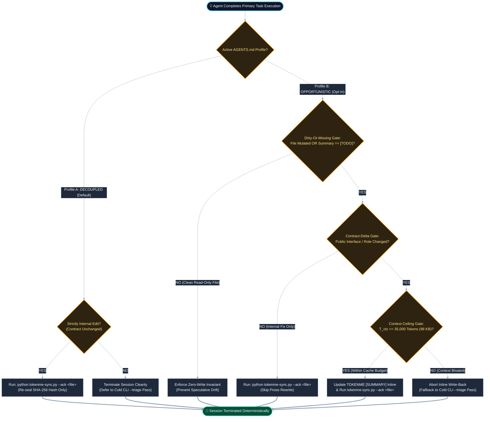

# ADR-014: Declarative Maintenance Execution Profiles and Single-State Instruction Isolation

* **Status:** Proposed
* **Date:** 2026-11-13
* **Author:** Elijah N. Dean, BSME (`endean-eng` / Dean Innovative Design LLC)
* **Target Specification:** `TOKENME` v2.0
* **Supersedes / Refines:** Extends ADR-006 (`tokenme-sync.py` Zero-Dependency CLI), ADR-011 (Cryptographic Hash State Taxonomy), and ADR-013 (Byte-Budgeting & Hysteresis Bounds)

---

## 1. Context & Problem Statement

In multi-agent software engineering workflows governed by `TOKENME` v2.0, every tracked repository file maintains a declarative summary entry inside `./TOKENME.txt` (or its hierarchical shards) paired with a deterministic SHA-256 content hash. When an execution agent creates or mutates a file, the cryptographic hash drifts, transitioning the file's epistemic state to `[STALE]` or `[TRIAGE]`.

A fundamental tokenomic tension exists between two maintenance architectures for resolving these declarative summaries:

1. **Cold Maintainer Synchronization (Decoupled Pass):** The execution agent mutates source code and terminates immediately. A subsequent run of `tokenme-sync.py --triage` flags hash mismatches, and a dedicated documentation pass ingests the modified files from cold storage to update their `[SUMMARY]` blocks. While contextually clean, this approach pays a redundant $1.0\times$ uncached input token penalty to re-read the system prompt ($T_{\text{sys}}$), the index ($T_{\text{index}}$), and the target source file ($T_{\text{file}}$).
2. **Opportunistic End-of-Session Write-Back (Piggyback Pass):** Because the active execution agent has already loaded $T_{\text{sys}}$ and $T_{\text{file}}$ into its working Key-Value (KV) prompt cache during the coding task, updating the `TOKENME` declarative prior to session termination leverages discounted cached input tokens ($r_{\text{cache}} \in [0.10, 0.25]$) and avoids spawning a second agent instance.

However, unconstrained opportunistic write-back introduces three severe failure modes:

* **Speculative Drift on Clean Ingested Files:** If an agent is instructed to update declaratives for *all* files ingested during a session (rather than strictly files it mutated), it rewrites summaries for read-only dependency files through the narrow bias of the current task, destroying invariant architectural context and burning high-cost output tokens ($T_{\text{out}}$).
* **Late-Context Attention Degradation:** After extended debugging loops ($T_{\text{ctx}} > 35,000\text{ tokens}$), the session context is polluted with stack traces, rejected diffs, and intermediate tool calls. Summaries generated at the tail end of deep sessions over-index on transient bug fixes rather than module-level contracts, while the cumulative cost of carrying $r_{\text{cache}} \cdot T_{\text{ctx}}$ across an extra tool-call turn eventually exceeds the cost of a fresh cold-maintainer pass.
* **Inactive Instruction Bloat & Semantic Priming in `AGENTS.md`:** Attempting to support both workflows by leaving an inactive or commented-out rule block (`<!-- ... -->`) inside `AGENTS.md` fails at the tokenizer level. LLM tokenizers do not strip Markdown/HTML comments prior to KV-cache projection. Dormant instructions consume input tokens on every turn and induce **Semantic Priming (Logit Bleed)** and **Ironic Process Errors (Negation Blindness)**, where high-salience action nouns (`update`, `TOKENME`, `summary`, `terminating`) elevate the probability of the forbidden behavior despite syntactic negation or comment delimiters.

---

## 2. Decision & Governing Mechanics

`TOKENME` v2.0 formally establishes two mutually exclusive **Declarative Maintenance Execution Profiles** (**Profile A: Decoupled Cold Triage** as the canonical default, and **Profile B: Bounded Opportunistic Write-Back** as an explicit opt-in) governed by a strict **Single-State Instruction Isolation** invariant.



### 2.1 Tokenomic Crossover Derivation

Let the token parameters of a single file modification and documentation cycle be defined as:

* $T_{\text{sys}}$: System prompt and active `AGENTS.md` instruction payload ($\approx 2,500\text{ tokens}$)
* $T_{\text{file}}$: Target source file token footprint ($\approx 3,000\text{ tokens}$)
* $T_{\text{index}}$: `./TOKENME.txt` or target shard footprint ($\approx 1,500\text{ tokens}$)
* $T_{\text{ctx}}$: Accumulated conversational, tool-call, and reasoning history at session termination
* $T_{\text{out}}$: Output token generation required for the declarative update ($\approx 200\text{ tokens}$)
* $r_{\text{cache}}$: Provider prompt-cache input discount ratio ($0.10 \le r_{\text{cache}} \le 0.25$)

The uncached input equivalent cost $C_{\text{cold}}$ of invoking a dedicated cold maintainer pass is:

$$C_{\text{cold}} = T_{\text{sys\_minimal}} + T_{\text{file}} + T_{\text{index}}$$

The uncached input equivalent cost $C_{\text{piggyback}}$ of executing an extra tool-call turn at the end of an active coding session (assuming `./TOKENME.txt` must be read fresh if not already cached, while $T_{\text{sys}} + T_{\text{file}} + T_{\text{ctx}}$ are served from the KV cache) is:

$$C_{\text{piggyback}} = r_{\text{cache}} \cdot (T_{\text{sys}} + T_{\text{file}} + T_{\text{ctx}}) + T_{\text{index}}$$

For the opportunistic write-back turn to remain strictly cheaper than a cold maintainer pass ($C_{\text{piggyback}} < C_{\text{cold}}$), the accumulated session context $T_{\text{ctx}}$ must satisfy:

$$T_{\text{ctx}} < \frac{T_{\text{sys\_minimal}} + T_{\text{file}}}{r_{\text{cache}}} - (T_{\text{sys}} + T_{\text{file}})$$

Substituting conservative baseline values ($T_{\text{sys}} = T_{\text{sys\_minimal}} = 2,500$, $T_{\text{file}} = 3,000$, and a mid-tier cache factor $r_{\text{cache}} = 0.135$):

$$T_{\text{ctx}} < \frac{5,500}{0.135} - 5,500 \approx 35,240\text{ tokens}$$

Applying the `TOKENME` v2.0 conservative cross-tokenizer density bound of $2.8\text{ UTF-8 bytes/token}$ (per ADR-013), the hard **Context-Ceiling Gate** is fixed at **$35,000\text{ tokens}$ ($\approx 98,000\text{ UTF-8 bytes}$)**.

### 2.2 Execution Profile Specifications

| Dimension | Profile A: Decoupled Cold Triage (`DEFAULT`) | Profile B: Bounded Opportunistic Write-Back (`OPT-IN`) |
| :--- | :--- | :--- |
| **Target Workflow** | Multi-agent pipelines, deep refactoring, CI/CD automated indexing, high-contention repos | Single-agent interactive sessions, surgical feature additions, low-context-depth edits |
| **End-of-Session Action** | Agent mutates code, runs `--ack` only on non-contract internal edits, and exits immediately | Agent updates `[SUMMARY]` inline before termination if all 3 safety gates pass |
| **Read-Only Ingested Files** | Untouched | Untouched unless current `[SUMMARY]` is explicitly `[TODO]` or `NULL` |
| **Internal-Only Code Edits** | Run `python tokenme-sync.py --ack <file>` | Run `python tokenme-sync.py --ack <file>` (Zero prose rewrite) |
| **Context Ceiling ($T_{\text{ctx}}$)** | Unbounded (No end-of-session summarization turn) | Hard cutoff at $\le 35,000\text{ tokens}$ ($\le 98\text{ KB}$); above ceiling falls back to Profile A |

### 2.3 Three Hard Gates for Profile B (`OPPORTUNISTIC_WRITEBACK`)

Repositories opting into Profile B enforce three deterministic invariants:

1. **Gate 1 — Dirty-Or-Missing Prerequisite:** An agent may only write a `TOKENME` declarative for a file it **created or modified** during the active session, OR an ingested file whose current summary is literally `[TODO]`. Updating valid summaries of read-only ingested files is forbidden.
2. **Gate 2 — Contract-Delta Threshold:** If a write mutation is strictly internal (e.g., local bug fix, formatting, comment refinement, constant tuning) and does not alter the file's exported symbols, CLI arguments, data schema, or architectural responsibility, the agent skips prose generation and executes `python tokenme-sync.py --ack <file>` to re-seal the SHA-256 hash.
3. **Gate 3 — Context-Ceiling Cutoff ($T_{\text{ctx}} \le 35\text{k}$ tokens):** Inline declarative updates are permitted only when total session context remains under $35,000\text{ tokens}$ ($98\text{ KB}$). If multi-turn debugging pushes the session past this boundary, the agent terminates without updating prose, deferring to `tokenme-sync.py --triage`.

### 2.4 Single-State Instruction Isolation Invariant

> [!WARNING]
> **Zero Dormant Instructions in `AGENTS.md`:** `AGENTS.md` MUST contain only the active execution profile's instructions. Dormant profiles, commented-out Markdown blocks (`<!-- ... -->`), and negative descriptions of inactive modes are strictly prohibited inside `AGENTS.md`.

To prevent token waste and attention dilution:
* Out of the box, `AGENTS.md` ships with **Profile A** exclusively.
* The exact drop-in replacement block for **Profile B** is stored in cold documentation (`ADR-014` and `README.md`), where it incurs zero token cost and zero logit bleed during standard agent execution.

---

## 3. Rejected Alternatives & Technical Postmortems (DO NOT RE-IMPLEMENT)

* **Rejected Option 1 (Unbounded Piggyback Updates on All Ingested Files):** Instructing agents to update declaratives for *"any files ingested or updated"* before terminating was rejected. Agents routinely ingest 4 to 10 upstream dependency files for context while modifying only 1 target file. Rewriting summaries for clean dependencies wastes expensive output tokens ($T_{\text{out}}$ is $4\times$ to $5\times$ the price of $T_{\text{in}}$) and induces task-biased summary drift.
* **Rejected Option 2 (Marking Opportunistic Write-Back as a `REJECTED` ADR):** Recording the piggyback optimization as a `REJECTED` ADR to keep it out of the default workflow was rejected due to **Epistemic Poisoning**. Under `TOKENME` governance, agents inspecting `docs/decisions/` interpret `Status: Rejected` as a banned architectural anti-pattern, causing them to refuse or flag the workflow even when a repository maintainer explicitly configures it.
* **Rejected Option 3 (Commented-Out Profile Toggle Inside `AGENTS.md`):** Embedding Profile B inside `<!-- ... -->` HTML comments within `AGENTS.md` for convenience was rejected. BPE tokenizers encode HTML comments into the active context window on every turn, burning tokens continuously and priming the transformer's attention heads with the exact action verbs (`update`, `SUMMARY`, `before terminating`) that Profile A seeks to suppress.

---

## 4. Consequences & Engineering Trade-Offs

* **Positive — Zero Default Token Overhead & High Signal Purity:** Default repositories using Profile A pay zero extra tokens in `AGENTS.md` and remain completely insulated from late-context summary corruption and semantic priming.
* **Positive — Quantified Opt-In Path for Low-Context Workflows:** Teams running short, surgical coding sessions ($T_{\text{ctx}} < 35\text{k}$) can swap the Profile B block into `AGENTS.md` from `README.md` to capture up to a $66\%$ reduction in declarative maintenance token costs without risking speculative drift on read-only files.
* **Trade-Off — Manual Profile Swap in `AGENTS.md`:** Switching between Profile A and Profile B requires replacing a 3-line Markdown section in `AGENTS.md` (or running a configuration task) rather than toggling an inline comment, a deliberate trade-off to guarantee zero-token cold isolation.

---

## 5. Proposed Implementation Specification (Repository Delta)

### 5.1 Active Default Block in `AGENTS.md` (Profile A — Ships Active)

Ensure the declarative synchronization section of `./AGENTS.md` contains strictly the active Profile A positive ruleset with zero references to Profile B or HTML comments:

```markdown
### Epistemic State & Declarative Sync
- Rely on `python tokenme-sync.py --triage` to detect SHA-256 hash drift (`[STALE]` / `[TRIAGE]`) after file mutations.
- When a code modification is strictly internal (bug fix, refactoring, comments) and preserves the file's public interface and architectural contract, run `python tokenme-sync.py --ack <path>` to re-seal the cryptographic hash.
```

### 5.2 Opt-In Documentation & Swap Block in `README.md`

Append the following configuration section to `./README.md` so maintainers can opt into Profile B via clean block replacement:

```markdown
## Declarative Maintenance Execution Profiles (ADR-014)

By default, `TOKENME` v2.0 ships with **Profile A (Decoupled Cold Triage)** active in `AGENTS.md`. To prevent token waste and transformer semantic priming (logit bleed from commented-out instructions), inactive profiles are never stored inside `AGENTS.md`.

### Switching to Profile B (Bounded Opportunistic Write-Back)
For workflows dominated by short, surgical agent sessions ($T_{\text{ctx}} \le 35,000\text{ tokens}$), you can leverage the active agent's warm KV prompt cache to update declaratives inline prior to session termination. Replace the `### Epistemic State & Declarative Sync` section in `AGENTS.md` with the following block:

```markdown
### Epistemic State & Declarative Sync
- Before terminating your session, if total session context is under 35,000 tokens (98 KB), update the `TOKENME` `[SUMMARY]` for any file you created or modified whose public interface or architectural role changed, and for any ingested file whose current summary is `[TODO]`, then run `python tokenme-sync.py --ack <path>`.
- When a file modification is strictly internal and preserves the file's architectural contract, leave the existing summary untouched and run `python tokenme-sync.py --ack <path>`.
```
```

### 5.3 `./TOKENME.txt` Continuity Entry Addition

Register the new ADR inside the `docs/decisions/` shard or root `./TOKENME.txt` manifest:

```text
docs/decisions/ADR-014_2026-11-13_Declarative-Maintenance-Execution-Profiles.md | [VALID] | sha256:<PENDING_SYNC>
  [SUMMARY]: Defines Profile A (Decoupled Cold Triage, default) and Profile B (Bounded Opportunistic Write-Back, opt-in <=35k tokens, dirty/missing-only) for declarative maintenance. Enforces Single-State Instruction Isolation in AGENTS.md to prevent dormant-comment token burn and semantic priming.
```