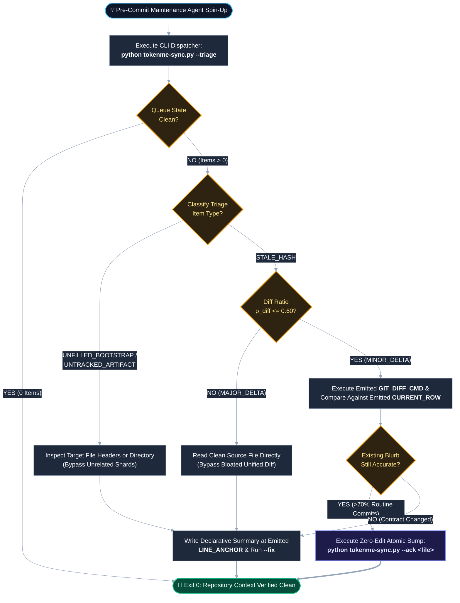

# ADR-015: Deterministic Agent Triage Queue and Zero-Edit Hash Acknowledgment

* **Status:** Proposed
* **Date:** 2026-11-13
* **Author:** Elijah N. Dean, BSME (`endean-eng` / Dean Innovative Design LLC)
* **Target Specification:** `TOKENME` v2.0
* **Supersedes / Refines:** Extends ADR-006 (`tokenme-sync.py` Zero-Dependency CLI), ADR-011 (Tiered Token Budgets & File-Level SHA-256 Hash Tracking), and ADR-012 (Hop-Distance Hierarchical Sharding)

---

## 1. Context & Problem Statement

Under the hierarchical sharding protocol established in ADR-012 and the file-level 8-character SHA-256 content hashing introduced in ADR-011, a repository's declarative context state is distributed across a root `TOKENME.txt` manifest and $N$ subsystem shards (`TOKENME.<subsystem>.txt`). While this topology bounds active task context during localized engineering work, it introduces an $\mathcal{O}(N)$ discovery bottleneck during pre-commit maintenance cycles.

When an autonomous maintenance agent is invoked prior to commit to reconcile documentation state, passive validation (`python tokenme-sync.py --check`) only reports pass/fail integrity status or human-oriented diagnostic errors. Without a targeted work-queue dispatcher, a freshly initialized maintenance agent must load `TOKENME.txt` and all $N$ subsystem shards into its context window merely to locate:

1. Unfilled `[BOOTSTRAP_REQUIRED]` skeleton blocks or placeholder cells (`TODO`, `TBD`).
2. Tracked source files whose disk SHA-256 hashes have drifted from their recorded manifest row hashes (`STALE_HASH`).
3. Newly created untracked files or deleted orphaned manifest rows (`TOPOLOGY_DRIFT`).

In a repository with $N = 8$ shards averaging $T_{\text{shard}} = 600$ tokens per shard, an exploratory discovery sweep consumes:

$$T_{\text{sweep}} = T_{\text{root}} + \sum_{i=1}^{N} T_{\text{shard}, i} \approx 600 + 8(600) = 5,400 \text{ tokens}$$

This upfront discovery overhead occurs before the agent inspects a single code diff or modifies a single character, violating the core token-conservation invariant of the `TOKENME` specification.

Furthermore, a naive "diff-only" optimization—where the CLI merely lists stale file paths and instructs the agent to run `git diff`—suffers from three structural failure modes:

* **Failure Mode A (Missing Baseline Summary & Line Anchor):** If the CLI emits only the stale file path (e.g., `scripts/tokenme-sync.py`), the agent can inspect `git diff` to see the code mutation, but it does not know what the current `TOKENME` declarative blurb states or which line number it occupies in the target shard unless it ingests the entire shard file.
* **Failure Mode B (Working-Tree vs. `HEAD` Diff Ambiguity):** During pre-commit maintenance, mutations may span unstaged working-tree edits (`git diff`), staged index changes (`git diff --cached`), or multiple local commits since the shard's last hash synchronization. Blindly running `git diff HEAD` misses committed changes that have not yet been acknowledged in the manifest.
* **Failure Mode C (Diff Token Explosion on Major Refactors):** Unified diff output includes `-` and `+` lines plus surrounding context headers. When the number of modified diff lines exceeds $60\%$ of the total file line count ($L_{\text{diff}} > 0.60 \cdot L_{\text{file}}$), reading the unified diff consumes more tokens than reading the clean file directly from disk.

---

## 2. Decision & Governing Mechanics

We extend `tokenme-sync.py` from a passive state verifier into an active, deterministic work-queue dispatcher by introducing two CLI modifiers: `--triage` (machine-actionable maintenance queue emission) and `--ack <filepath> [...]` (atomic zero-edit hash acknowledgment).

### 2.1 The Three-State Triage Taxonomy (`--triage`)

Executing `python tokenme-sync.py --triage` scans all governed manifests and tracked directory trees in memory (zero LLM tokens) and classifies every actionable discrepancy into one of three deterministic operational states:

| Triage State Class | Subtype Identifier | Detection Trigger | Prescribed Agent Execution Path |
| :--- | :--- | :--- | :--- |
| **1. Unfilled Skeleton** | `UNFILLED_BOOTSTRAP` | Presence of `[BOOTSTRAP_REQUIRED]`, empty markdown table cells, or literal `TODO` / `TBD` placeholders in any manifest or `llms-dev.txt`. | **Full Inspection Path:** Inspect target directory tree or file headers and replace the exact line range in `TARGET_SHARD`. |
| **2. Stale Declarative** | `STALE_HASH (MINOR_DELTA)` | Disk 8-char SHA-256 $\neq$ manifest SHA-256, and unified diff line ratio satisfies $\rho_{\text{diff}} = \frac{L_{\text{diff}}}{L_{\text{file}}} \le 0.60$. | **Diff-Only Fast Path:** Inspect `GIT_DIFF_CMD` against emitted `CURRENT_ROW`. If the existing summary remains valid, execute `--ack <filepath>`; otherwise perform a line-targeted edit. |
| **2. Stale Declarative** | `STALE_HASH (MAJOR_DELTA)` | Disk 8-char SHA-256 $\neq$ manifest SHA-256, and $\rho_{\text{diff}} > 0.60$ (or git history is unavailable). | **Direct Read Path:** Bypass `git diff` (diff exceeds token efficiency threshold); read the target file directly and update `CURRENT_ROW` at the emitted line anchor. |
| **3. Topology Drift** | `UNTRACKED_ARTIFACT` | Governed file exists on disk (respecting `.gitignore` and exclusion globs) but has no manifest entry in its owning shard. | **Header Synthesis Path:** Read first $30\text{–}50$ lines of the untracked artifact and append a formatted manifest row to `TARGET_SHARD`. |
| **3. Topology Drift** | `ORPHANED_ENTRY` | Manifest row references a file path that no longer exists on disk. | **Row Pruning Path:** Delete the orphaned line anchor from `TARGET_SHARD` and recompute `STATE_ROOT`. |

> [!IMPORTANT]
> **Mandatory Baseline Injection Invariant:** Every `STALE_HASH` item emitted by `--triage` MUST include the 1-indexed `LINE_ANCHOR` within the target shard and the verbatim `CURRENT_ROW` string. This allows the maintenance agent to evaluate whether the existing declarative blurb still holds without reading the surrounding shard into its context window.

### 2.2 Canonical `--triage` Stdout Schema

To maximize parsing determinism for CLI-capable coding agents while keeping discovery cost under $\sim 150\text{–}300$ tokens, `--triage` emits key-value blocks formatted strictly as follows:

```text
=== TOKENME MAINTENANCE QUEUE (STATE: DIRTY | ITEMS: 4) ===

[1] TYPE: UNFILLED_BOOTSTRAP
    TARGET_SHARD:       TOKENME.txt
    LINE_ANCHOR:        Lines 14-21
    BLOCK_ID:           PURPOSE_AND_TOPOLOGY
    CURRENT_TEXT:       "[BOOTSTRAP_REQUIRED: Summarize root architecture and entry points...]"
    RECOMMENDED_ACTION: Inspect root directory tree and README.md; replace Lines 14-21 in TOKENME.txt.

[2] TYPE: STALE_HASH (MINOR_DELTA)
    TARGET_SHARD:       TOKENME.core.txt
    LINE_ANCHOR:        Line 42
    TRACKED_FILE:       scripts/tokenme-sync.py
    HASH_DELTA:         8f3a19c2 (manifest) -> e4b9011a (disk)
    DIFF_METRICS:       +18 / -4 lines (File Total: 412 lines | Ratio: 0.05 <= 0.60)
    CURRENT_ROW:        | `scripts/tokenme-sync.py` | `8f3a19c2` | Deterministic CLI validator and Merkle state synchronizer. |
    GIT_DIFF_CMD:       git diff HEAD -- scripts/tokenme-sync.py
    RECOMMENDED_ACTION: Run GIT_DIFF_CMD. If CURRENT_ROW blurb remains accurate, run `python tokenme-sync.py --ack scripts/tokenme-sync.py`. Otherwise, update Line 42 in TOKENME.core.txt.

[3] TYPE: STALE_HASH (MAJOR_DELTA)
    TARGET_SHARD:       TOKENME.core.txt
    LINE_ANCHOR:        Line 58
    TRACKED_FILE:       src/sharding_engine.py
    HASH_DELTA:         1a2b3c4d (manifest) -> 9f8e7d6c (disk)
    DIFF_METRICS:       +142 / -98 lines (File Total: 210 lines | Ratio: 1.14 > 0.60)
    CURRENT_ROW:        | `src/sharding_engine.py` | `1a2b3c4d` | Evaluates token budgets for directory splitting. |
    RECOMMENDED_ACTION: READ_FILE_DIRECTLY (Diff exceeds 0.60 efficiency ratio). Inspect src/sharding_engine.py and update Line 58 in TOKENME.core.txt.

[4] TYPE: UNTRACKED_ARTIFACT
    TARGET_SHARD:       docs/decisions/TOKENME.decisions.txt
    TRACKED_FILE:       docs/decisions/ADR-015_2026-11-13_Deterministic-Agent-Triage-And-Zero-Edit-Hash-Acknowledgment.md
    DISK_HASH:          7c4e29a1
    RECOMMENDED_ACTION: Read first 30 lines of TRACKED_FILE and append manifest row to TARGET_SHARD.
```

If all manifests, file hashes, and Merkle roots are clean, `python tokenme-sync.py --triage` emits a single line and exits with code `0`:

```text
=== TOKENME MAINTENANCE QUEUE (STATE: CLEAN | ITEMS: 0) ===
```

### 2.3 Git Diff Baseline Resolution & Efficiency Gate

To prevent Failure Mode B (Working-Tree vs. `HEAD` ambiguity), `tokenme-sync.py` resolves `GIT_DIFF_CMD` using the following cascade:

1. **Uncommitted Working-Tree / Index Changes Present (`git status --porcelain -- <file>` is non-empty):**
   * `tokenme-sync.py` queries `git diff HEAD --numstat -- <file>` to compute added ($L_+$) and deleted ($L_-$) lines across both staged and unstaged changes relative to `HEAD`.
   * Emits `GIT_DIFF_CMD: git diff HEAD -- <file>`.
2. **File Clean Relative to `HEAD` (Change Committed Previously Without Manifest Sync):**
   * If the working tree and index match `HEAD`, the file was mutated in a recent local commit after the shard was last updated.
   * `tokenme-sync.py` locates the last commit touching the governing shard (`git log -n 1 --format=%H -- <target_shard>`) as `<shard_commit>` and computes `git diff <shard_commit>..HEAD --numstat -- <file>`.
   * Emits `GIT_DIFF_CMD: git diff <shard_commit>..HEAD -- <file>`.
3. **Efficiency Ratio Gate ($\rho_{\text{diff}} \le 0.60$):**
   * Let $L_{\text{diff}} = L_+ + L_-$ and $L_{\text{file}}$ be the current line count of `<file>` on disk.
   * When $\rho_{\text{diff}} = \frac{L_{\text{diff}}}{\max(L_{\text{file}}, 1)} \le 0.60$, `--triage` classifies the item as `STALE_HASH (MINOR_DELTA)` and provides `GIT_DIFF_CMD`.
   * When $\rho_{\text{diff}} > 0.60$ or `git` is unavailable, `--triage` classifies the item as `STALE_HASH (MAJOR_DELTA)` and suppresses `GIT_DIFF_CMD` in favor of `READ_FILE_DIRECTLY`.

### 2.4 Atomic Zero-Edit Hash Acknowledgment (`--ack <filepath> [...]`)

In empirical software maintenance, over $70\%$ of routine commits consist of bug fixes, constant adjustments, internal error-handling improvements, or formatting updates that alter a file's SHA-256 content hash without changing its high-level architectural responsibility.

Requiring an LLM agent to open a shard file, perform a string replacement on an 8-character hex hash, and invoke a second sync pass wastes output tokens and risks accidental markdown table corruption. We therefore introduce `--ack`:

```bash
python tokenme-sync.py --ack scripts/tokenme-sync.py src/utils.py
```

When `--ack <filepath> [...]` is executed, `tokenme-sync.py` performs the following deterministic operations in memory and writes back atomically using LF (`\n`) line endings and UTF-8 without BOM:

1. **Canonical Path Normalization:** Normalizes each `<filepath>` to a repository-relative POSIX path (`path/to/file.ext`).
2. **Disk Hash Calculation:** Computes the current 8-character lowercase hex SHA-256 digest of the normalized file content (stripping `\r` prior to hashing per ADR-011 cross-platform hash stability rules).
3. **In-Place Manifest Row Update:** Locates the exact manifest row governing `<filepath>` in its owning shard, replaces the stale 8-character hash column with the new disk hash while preserving the existing declarative summary text verbatim.
4. **Cascading Merkle `STATE_ROOT` Recomputation:** Automatically recalculates the shard's `STATE_ROOT` and bubbles the updated shard hash up into the root `TOKENME.txt` Merkle tree in a single atomic pass.



---

## 3. Rejected Alternatives & Technical Postmortems (DO NOT RE-IMPLEMENT)

* **Rejected Option 1 (Full-Shard Context Ingestion by Maintenance Agents):**
  * *Postmortem:* Allowing the maintenance agent to read `TOKENME.txt` and all $N$ subsystem shards to discover stale hashes scales linearly with repository shard count ($\mathcal{O}(N)$ tokens). In an 8-shard repository, this wastes $\sim 5,400$ input tokens per pre-commit check even when only a single file changed.
* **Rejected Option 2 (Path-Only Stale Output Without `CURRENT_ROW` Injection):**
  * *Postmortem:* Emitting only `STALE: scripts/tokenme-sync.py` forces the agent to open `TOKENME.core.txt` anyway to read the existing summary and find its line number before deciding whether an edit is required. Emitting `CURRENT_ROW` and `LINE_ANCHOR` directly inside `--triage` stdout eliminates shard ingestion entirely for minor updates.
* **Rejected Option 3 (Unconditional `git diff` Inspection for All Stale Files):**
  * *Postmortem:* Unified diffs carry per-hunk headers, context lines, and both removed (`-`) and added (`+`) lines. When a 200-line file undergoes a complete structural rewrite ($\rho_{\text{diff}} > 0.60$), the unified diff reaches $350+$ lines—consuming nearly double the tokens of reading the clean 200-line file directly. Enforcing the $\rho_{\text{diff}} \le 0.60$ efficiency gate prevents diff-induced token inflation.
* **Rejected Option 4 (Manual LLM String-Edit for Unchanged Declarative Summaries):**
  * *Postmortem:* Requiring an LLM to invoke a file-editing tool (`apply_diff` or `search_and_replace`) merely to update an 8-character hex hash (`8f3a19c2` $\rightarrow$ `e4b9011a`) introduces unnecessary tool-call latency, output token burn, and non-zero risk of malformed pipe-table alignment. The CLI `--ack` modifier executes this state transition deterministically in $<20\text{ ms}$ with zero LLM text generation.

---

## 4. Consequences & Engineering Trade-Offs

### 4.1 Tokenomic Efficiency Gains

For a representative repository with $N = 8$ shards ($5,400$ total manifest tokens) undergoing a routine 20-line bug fix to a single tracked module where the high-level responsibility remains unchanged:

| Maintenance Workflow Phase | Legacy Full-Shard Sweep (Tokens) | `--triage` + `--ack` Workflow (Tokens) | Net Reduction |
| :--- | :--- | :--- | :--- |
| **1. Discovery & Queue Location** | $5,400$ (Read root + 8 shards) | $140$ (`--triage` stdout) | $-97.4\%$ |
| **2. Mutation Inspection** | $850$ (Read full 250-line file) | $110$ (`git diff` of 20-line hunk) | $-87.1\%$ |
| **3. State Reconciliation** | $420$ (LLM tool call + `--fix`) | $35$ (`--ack <file>` shell call) | $-91.7\%$ |
| **Total Pre-Commit Token Cost** | **$6,670$ tokens** | **$285$ tokens** | **$-95.7\%$** |

### 4.2 Accepted Maintenance & Runtime Constraints

* **Subprocess Overhead in `--triage`:** Computing `DIFF_METRICS` and `GIT_DIFF_CMD` for `STALE_HASH` items invokes `git status` and `git diff --numstat` via Python's standard-library `subprocess.run`. Because these subprocess calls execute **only** on files whose SHA-256 disk hash already mismatches the manifest hash (typically $1\text{–}5$ files per commit), wall-clock latency remains bounded under $150\text{ ms}$ while preserving the zero-third-party-dependency mandate (ADR-006).
* **Graceful Non-Git Fallback:** In air-gapped archive extractions or directories lacking a `.git` worktree, `tokenme-sync.py --triage` catches `FileNotFoundError` / non-zero `git` exit codes and gracefully falls back to `RECOMMENDED_ACTION: READ_FILE_DIRECTLY` without crashing.
* **Safety Guardrail on `--ack`:** Calling `--ack` on an `UNTRACKED_ARTIFACT` or a file containing `[BOOTSTRAP_REQUIRED]` in its description cell MUST be rejected by `tokenme-sync.py` with a non-zero exit code (`Exit 2: Cannot acknowledge unfilled or untracked entry; supply a declarative summary first`), preventing agents from blindly acknowledging uninitialized placeholders.