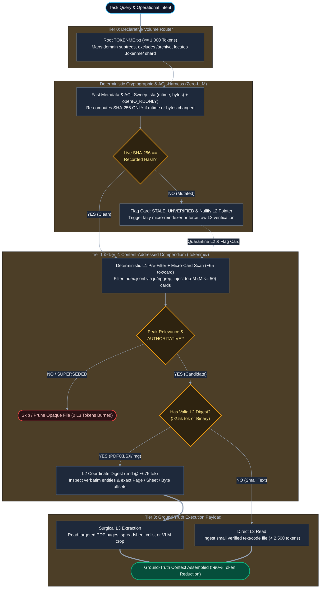

# TOKENME (.txt) v2.0: Multi-Resolution Filesystem Indexing and Enterprise Organizational Epistemics

**Subtitle:** Extending the Declarative Context Triad from Software Repositories to Heterogeneous Enterprise Storage via Content-Addressed Epistemic Compendiums  
**Author:** Elijah N. Dean, BSME — Principal & Lead Engineer, Dean Innovative Design LLC  
**Publication Date:** November 10, 2026  
**Specification Version:** 2.0.0-beta (Backwards-Compatible Extension to `TOKENME` v1.1)  
**Canonical Namespace:** `TOKENME.txt` (L0 Router) + `.tokenme/` (L1/L2 Sidecar Compendium)  
**License:** Creative Commons Attribution 4.0 International (CC-BY 4.0)  

---

## Abstract

Software repositories represent a clean, text-native minority of enterprise knowledge. Across industrial, engineering, legal, and operational organizations, institutional ground truth resides in heterogeneous file systems populated by scanned legacy PDFs, spreadsheets, CAD assemblies, equipment photographs, and superseded project folders. Existing retrieval paradigms fail this environment at opposite extremes: naive agentic file traversal suffers catastrophic token exhaustion and context dilution by ingesting irrelevant or deprecated files, while Vector Retrieval-Augmented Generation (RAG) strips document topology, ignores file lifecycle authority, and introduces brittle database infrastructure.

This paper introduces **`TOKENME` v2.0**, extending the v1.1 Repository Context Triad (`README.md`, `AGENTS.md`, `TOKENME.txt`) into an enterprise-wide **Organizational Epistemics** protocol. Drawing on computer graphics mipmapping and content-addressable storage, `TOKENME` v2.0 establishes a four-layer progressive disclosure hierarchy (`L0` Domain Router $\rightarrow$ `L1` Cryptographic Micro-Card $\rightarrow$ `L2` Extractive Coordinate Digest $\rightarrow$ `L3` Surgical Ground-Truth Slice) stored entirely in portable, flat UTF-8 sidecar files (`.tokenme/`). By pairing deterministic two-stage `stat(mtime, bytes)` + `SHA-256` staleness gates with normalized substring-verified extractive indexing, the protocol eliminates silent metadata drift, prevents deprecated parameters from polluting active reasoning, enforces OS-level Access Control List (ACL) boundaries, and reduces multi-file enterprise retrieval token overhead by $>90\%$ without external database dependencies.

---

## 1. Introduction: Applied AI as Organizational Epistemics

The prevailing enterprise AI narrative treats retrieval failure as a model capability deficit—assuming larger context windows or higher-dimensional vector embeddings will allow autonomous agents to navigate messy shared drives. First-principles systems analysis reveals the opposite: **enterprise AI failure is primarily an organizational epistemics and information-governance failure.**

In a single software repository, **`TOKENME` v1.1** resolved context orientation by separating repository documentation into three orthogonal primitives:
1. **`README.md` (Teleological / Human Narrative):** Why the system exists and how humans onboard.
2. **`AGENTS.md` (Imperative / Behavioral Rules):** How autonomous agents must act, validate, and respect boundaries.
3. **`TOKENME.txt` (Declarative / Live State):** What currently exists—active topology, exported symbols, invariants, and shard pointers.

However, the moment an engineering or operational workflow crosses outside a pure Git code repository into shared network drives (SMB/NTFS/NFS), engineering vaults, or compliance archives, two physical constraints break v1.1 symbol cataloging:
* **Opaque Binary & Composite Payloads:** `grep` and Abstract Syntax Tree (AST) parsers are blind to flat scanned PDFs, vendor datasheets, multi-tab `.xlsx` workbooks, multi-file CAD assemblies (`.sldasm`/`.step`), and field photographs (e.g., equipment nameplates or wired relay panels).
* **Lifecycle Ambiguity:** Enterprise directories routinely co-locate canonical production specifications alongside historical scratchpads, vendor quotes, and superseded drafts without machine-readable epistemic markers.

> [!IMPORTANT]
> **The Fundamental Paradox of Opaque Inspection**  
> Without an external epistemic index, an autonomous agent cannot determine whether an opaque file is authoritative, superseded, or irrelevant without first paying the token, latency, and attention tax to ingest it. Once an outdated or contradictory file enters the active context window, probabilistic anchor bias degrades downstream reasoning even if the agent attempts to disregard it.

---

## 2. Information-Theoretic Critique of Flat Tags and Vector RAG

### 2.1 Why Traditional File Tags Fail
Filesystem tags (`#hydraulics`, `#v2`, `#invoice`, `#draft`) have existed for decades yet consistently fail agentic retrieval because they are **zero-predicate scalars**. A flat tag declares topical association while omitting three governing epistemic dimensions:
1. **Authority State:** Does this file represent enacted production ground truth, an exploratory calculation, or a retired revision?
2. **Causal Direction:** Does this artifact *govern* downstream constraints or merely *reference* upstream specifications?
3. **Negative Scope (`anti_scope`):** What tempting false-positive assumptions must an agent *avoid* making based on the filename?

### 2.2 The Cost Function of Blind Ingestion
Let $N$ be the number of candidate files matching a naive filename or tag search, $k \ll N$ be the true authoritative files required for the task, and $\bar{T}$ be the mean token mass per file. Under blind or flat-tag traversal with false-positive inspection rate $\alpha$, expected retrieval cost $C_{\text{total}}$ is not merely linear in API billing—it compounds reasoning error via context saturation:

$$C_{\text{total}} = \underbrace{\left(k + \alpha(N - k)\right)\bar{T} \cdot c_{\text{tok}}}_{\text{Direct Token & Latency Tax}} + \underbrace{\Lambda_{\text{task}} \cdot P_{\text{err}}\!\left(\alpha(N - k)\bar{T},\, D_{\text{stale}}\right)}_{\text{Expected Epistemic Failure Cost}}$$

Where $c_{\text{tok}}$ is unit compute cost, $\Lambda_{\text{task}}$ is the operational cost of an engineering or business error, and $P_{\text{err}}$ increases monotonically with both irrelevant context volume ("lost-in-the-middle" attention dilution [1]) and the count of ingested deprecated files $D_{\text{stale}}$.

### 2.3 Why Vector RAG Fails Enterprise Epistemics
Standard Vector RAG chunks documents into arbitrary $500$-token windows and retrieves top-$K$ fragments via cosine similarity. In engineering and enterprise operations, cosine similarity is epistemically blind:
* **Chunk De-Contextualization:** A table of pressure tolerances on Page 87 of a PDF loses its governing header warning on Page 84 (*"Preliminary Prototype Ratings — Do Not Use for Production"*).
* **Revision Collision:** A superseded 2024 specification and an active 2026 specification have near-identical vector embeddings ($\cos\theta \approx 0.98$), guaranteeing both are injected simultaneously into the prompt.
* **Infrastructure Lock-In:** Vector databases require external server daemons, embedding model version pinning, and opaque binary indices that cannot be audited with standard text tools or portable filesystem backups.

---

## 3. Architecture: Progressive Epistemic Mipmapping (`L0`–`L3`)

In 3D computer graphics, **mipmapping** stores pre-computed, progressively lower-resolution representations of a texture so a rendering pipeline never loads a massive raw asset to evaluate a distant surface. **`TOKENME` v2.0** applies extractive mipmapping directly to the file system across four strict resolution tiers:

| Tier | Artifact Path | Token Budget | Coverage Rule | Primary Cognitive Role |
| :--- | :--- | :--- | :--- | :--- |
| **L0: Router** | `/TOKENME.txt` | $\le 1,000$ tokens | 1 per Volume / Repo Root | Domain topology, active directory map, global invariants, and pointers to `.tokenme/` shards. |
| **L1: Micro-Card** | `/.tokenme/index.jsonl` | $50\text{–}80$ tokens / candidate file ($\le 3,250$ tok injected) | **100% of active files** (Deterministically pre-filtered to top-$M$ candidates) | Binary Read/Skip Triage: cryptographic `sha256`, lifecycle `status`, controlled `facets`, dense `scope`, and `anti_scope`. |
| **L2: Structural Digest** | `/.tokenme/digests/<sha256_16>.md` | $300\text{–}800$ tokens / file ($\sim 675$ tok mean) | Files $>2,500$ tokens **OR** opaque binaries (PDF, image, `.xlsx`, CAD) | Verbatim entity table (part numbers, ratings, dates) + **Coordinate Offset Map** (page, line, or sheet/cell ranges). |
| **L3: Raw Payload** | Native File on Disk | $500\text{–}2,000$ tokens (surgical slice) | On-demand coordinate read | Ground-truth execution payload; agent extracts *only* the targeted page/cell slice identified in L2. |

### 3.1 Architecture & Zero-Trust Routing Flow

To prevent context window saturation on directories with thousands of files ($N > 1,000$) and avoid network I/O bottlenecks over SMB/NFS shares, the agentic harness executes a **two-stage fast-stat sweep** and **deterministic local pre-filtering** prior to LLM evaluation:



---

## 4. Formal Specification of `.tokenme/` Artifacts

### 4.1 Content-Addressable Sidecar Invariant (Move/Rename Immunity)
In enterprise file systems, users routinely reorganize folders (`Draft_Specs/` $\rightarrow$ `2026_Approved_Specs/`). Keying heavy L2 digests or supersession links by *file path* would destroy cached OCR/VLM work and break historical audit trails whenever a directory is renamed.

In `TOKENME` v2.0:
1. **`/.tokenme/index.jsonl`** maps relative `path` $\rightarrow$ `sha256`.
2. **`/.tokenme/digests/<sha256_16>.md`** keys L2 digests strictly by the first 16 hexadecimal characters (64 bits) of the file's `SHA-256` content hash.
3. Moving or renaming a 300 MB scanned service manual across folders requires updating a single `path` string in `index.jsonl` at **zero LLM token cost**.
4. No metadata is ever stored in NTFS Alternate Data Streams (ADS) or OS-specific extended attributes (`xattr`), guaranteeing bit-identical portability across Windows, Linux, macOS, Git, and SMB/NAS shares.

### 4.2 Tier 1 Schema: `index.jsonl` (Epistemic Micro-Card)
Each line in `/.tokenme/index.jsonl` is a valid, single-line UTF-8 JSON object adhering to a **strict 10-field core schema** (plus an optional `deps_sha256` field for composite assemblies), deterministically sorted in ascending lexicographical order by `path` to guarantee clean Git merge resolution:

```json
{"path":"manuals/hydraulics/series40_service.pdf","sha256":"4a7d1ed414474e4033ac29ccb8653d9b6f82a91c5d0e3b7a8c91d4f20a6e11c3","mtime":1762780800,"bytes":48219040,"mime":"application/pdf","status":"AUTHORITATIVE","facets":["domain:hydraulics","artifact:service-manual","equip:series-40"],"scope":"OEM service, relief valve calibration, and seal kit overhaul procedures for Series 40 closed-center load-sensing directional valves.","anti_scope":"Excludes open-center Series 40-OC manifolds (see series40_oc_supplement.pdf).","l2_digest":".tokenme/digests/4a7d1ed414474e40.md"}
```

#### Core 10-Field Definition & Composite Extension
1. `path` *(string, required)*: Relative POSIX-normalized path from the BOU root.
2. `sha256` *(string, required)*: Lowercase 64-character hex `SHA-256` digest of the raw file payload.
3. `mtime` *(integer, required)*: Last modification Unix epoch timestamp (seconds) for fast-stat gating.
4. `bytes` *(integer, required)*: Exact file size in bytes for fast-stat gating.
5. `mime` *(string, required)*: Canonical MIME type (`application/pdf`, `application/vnd.openxmlformats-officedocument.spreadsheetml.sheet`, etc.).
6. `status` *(string, required)*: Lifecycle authority state from the mandatory enumeration below.
7. `facets` *(array of strings, required)*: Controlled `namespace:value` tags validated against `.tokenme/taxonomy.json`.
8. `scope` *(string, required)*: Dense declarative summary ($\le 30$ tokens) of authoritative contents.
9. `anti_scope` *(string, required)*: Explicit negative boundaries preventing false-positive ingestion (`"NONE"` if not applicable).
10. `l2_digest` *(string or null, required)*: Relative path to `.tokenme/digests/<sha256_16>.md`, or `null` for small text files ($< 2,500$ tokens) or quarantined `STALE_UNVERIFIED` cards.
11. `deps_sha256` *(string, optional)*: Merkle rollup hash of linked child files for composite artifacts (e.g., multi-file CAD assemblies `.sldasm` referencing external `.sldprt` files, or `.zip` containers). If any child part mutates on disk, `deps_sha256` diverges and triggers `STALE_UNVERIFIED`.

#### Mandatory `status` Enumeration
Agents MUST evaluate `status` prior to reading any L2 or L3 artifact:
* `AUTHORITATIVE` — Enacted ground truth governing active operations or designs.
* `ACTIVE_WIP` — Unfinalized work in progress; requires human confirmation before treating parameters as binding.
* `REFERENCE_EXTERNAL` — Third-party datasheet, statutory regulation, or academic reference.
* `SUPERSEDED_BY:<sha256_16>` — Historical artifact retained for audit trail. Keys the replacement file by its 16-character content hash prefix (resolved dynamically via `index.jsonl`) to preserve move/rename immunity across directory reorganizations. Agents MUST follow the hash pointer to the replacement file unless explicitly conducting historical forensics.
* `ARCHIVED` — Inactive historical record excluded from standard operational queries.
* `STALE_UNVERIFIED` — Automatically injected by the deterministic fast-stat/hash gate whenever live disk `sha256` (or `deps_sha256`) diverges from the recorded hash. Simultaneously nullifies/quarantines `l2_digest` access until re-indexed.

### 4.3 Tier 2 Schema: Extractive Coordinate Digest (`<sha256_16>.md`)
To eliminate prose hallucination, L2 digests forbid narrative essays. They act strictly as **coordinate maps and verbatim entity tables** enabling surgical L3 slicing:

```markdown
---
sha256: 4a7d1ed414474e4033ac29ccb8653d9b6f82a91c5d0e3b7a8c91d4f20a6e11c3
source_mime: application/pdf
total_pages: 164
extraction_harness: docling-v2 + normalized-substring-gate-pass
ocr_confidence: HIGH
---
# L2 Digest: Series 40 Closed-Center Directional Valve Manual

## Verbatim Identifiers & Quantitative Bounds
- **Models Covered:** `S40-CC-12`, `S40-CC-16`, `S40-CC-20` [Pages 1-4]
- **Max Operating Pressure:** `3,625 PSI (250 bar)` [Page 12]
- **Standby Margin Pressure:** `200 +/- 15 PSI (13.8 bar)` [Page 86]
- **Seal Kit Part Numbers:** `SK-4099-V` (Viton), `SK-4099-N` (Buna-N) [Page 141]

## Structural Coordinate Map (L3 Slicing Targets)
- `[Pages 001-018]` General specifications, fluid cleanliness (ISO 4406 18/16/13), port threads.
- `[Pages 019-064]` Spool configurations, flow curves, pressure drop charts.
- `[Pages 065-098]` Load-sense relief valve calibration & compensator troubleshooting.
- `[Pages 099-138]` Disassembly, spool bore wear limits, torque sequence (`28 ft-lbs` tie-rods).
- `[Pages 139-164]` Exploded parts diagrams and seal cross-reference tables.
```

---

## 5. Harness Engineering: Overcoming LLM Summarization Unreliability

> [!WARNING]
> **Empirical Reliability Constraint**  
> In published long-context evaluations [1, 2] and internal engineering benchmarks, unconstrained single-pass LLM summarization (`"Summarize this 150-page PDF"`) exhibits a $15\text{–}30\%$ entity omission and numerical conflation rate on dense technical and financial documents. Relying on raw generative prose for enterprise indexing introduces unacceptable epistemic corruption.

`TOKENME` v2.0 achieves production reliability today—without waiting for hypothetical future model perfection—by enforcing a **four-stage deterministic/agentic indexing harness**:

### 5.1 Deterministic Pre-Extraction First
Before invoking any LLM or Vision-Language Model (VLM), local deterministic tools extract exact structural skeletons at zero token cost:
* **PDFs:** `pdfinfo`, `pdftotext`, or layout-aware document parsers such as IBM `Docling` [3] extract page counts, bookmarks, bounding boxes, and raw text layers per page.
* **Spreadsheets (`.xlsx`, `.csv`):** OpenXML/sheet parsers extract tab names, column headers, row counts, and formula boundary ranges (`Sheet1!A1:M420`).
* **Photographs / Scans:** `exiftool` extracts capture timestamps, GPS coordinates, and device metadata prior to VLM inspection.

### 5.2 Windowed Extractive Slot-Filling (No Freeform Prose)
Instead of feeding a 120,000-token manual into a single prompt, the harness processes bounded $5\text{–}10$ page windows using low-cost flash-tier models instructed *only* to populate verbatim identifiers, quantitative ratings, and page boundaries. Extractive slot-filling converts an ill-posed lossy compression task into a bounded named-entity and coordinate-mapping task.

### 5.3 Deterministic Normalized Substring-Grounding Gate
Every verbatim identifier (part number, standard code, numeric tolerance) emitted into an L2 digest is verified via an automated script against the raw OCR/text buffer of its cited page range. Because PDF text layers and OCR engines frequently introduce formatting artifacts (e.g., line-wrapped numbers `3625\nPSI`, digit-grouping commas `3,625`, or Unicode plus-minus symbols `±` vs. `+/-`), the verification gate applies **canonical token normalization** (stripping thousands separators, normalizing Unicode mathematical operators and dashes to ASCII equivalents, and collapsing contiguous whitespace/newlines) prior to comparison:
* **Pass:** Normalized substring match confirmed on `[Page X]`.
* **Quarantine:** Any identifier failing normalized substring verification is automatically tagged `[UNVERIFIED_OCR]` in the L2 file, forcing any downstream agent to crop and visually inspect the raw L3 image/page before relying on the value.

### 5.4 Controlled Facet Taxonomy (`AGENTS.md` Enforcement)
To prevent folksonomy tag drift (`#spec`, `#specs`, `#specification`, `#design-doc`), allowed `facets` namespaces (`domain:*`, `artifact:*`, `project:*`, `compliance:*`) are declared inside the volume's `AGENTS.md` or `.tokenme/taxonomy.json`. Any indexer proposing an out-of-schema tag fails schema validation and routes the tag to an `unclassified` review queue.

### 5.5 Lazy / Demand-Driven Indexing Economics
Enterprise NAS volumes frequently hold $100,000+$ historical files that are never queried. `TOKENME` v2.0 mandates **asymmetric lazy indexing**:
1. **Baseline Sweep:** Deterministic `stat` + `sha256` cataloging + lightweight L1 cards on active operational directories; legacy `/archive` trees are fenced behind a single L0 router exclusion rule.
2. **Just-In-Time L2 Promotion:** Heavy VLM/OCR L2 digests are generated lazily upon first query contact with an unindexed binary and cached permanently under `.tokenme/digests/<sha256_16>.md`. Break-even token ROI occurs on Query #1 or #2.

---

## 6. Socio-Technical Governance: Bounded Operational Units (BOUs)

Technology alone cannot rescue an organization whose human workflows continuously generate epistemic ambiguity. At enterprise scale, `TOKENME` v2.0 maps physical storage directly onto organizational accountability and operating-system security through **Bounded Operational Units (BOUs)**:

1. **Clear Custodianship:** Every directory subtree governed by a `TOKENME.txt` router maps to a defined BOU with an explicit human custodian responsible for `AUTHORITATIVE` vs. `SUPERSEDED_BY` lifecycle transitions.
2. **Two-Stage Fast-Stat & Cryptographic Dirty Sweeps:** To avoid saturating network I/O on multi-gigabyte SMB/NFS directories, agentic harnesses execute a sub-second metadata sweep (`stat(mtime, bytes)`) prior to task execution and recompute full `SHA-256` byte streams *strictly* on files where `mtime` or `bytes` has changed. Human edits made outside agentic tools never cause silent drift; they deterministically flip the L1 card to `STALE_UNVERIFIED` and quarantine any stale L2 pointer.
3. **ACL & Security Boundary Alignment (Zero Permission Leakage):** A `.tokenme/` compendium shard MUST NOT span across heterogeneous filesystem Access Control List (ACL) boundaries (e.g., mixing general engineering files with ITAR-restricted or HR-confidential files in a single shared `index.jsonl`). Furthermore, agentic harnesses MUST verify OS-level read permission (`open(path, O_RDONLY)`) on the target L3 file *before* surfacing its L1 Micro-Card or L2 Digest to a user or model context.
4. **Concurrency & Atomic Write Semantics:** Whereas L2 digest writes (`.tokenme/digests/<sha256_16>.md`) are content-addressed and inherently idempotent, updates to `/.tokenme/index.jsonl` MUST acquire an advisory lockfile (`.tokenme/index.jsonl.lock`), sort records lexicographically by `path`, write to a temporary file (`.tokenme/index.jsonl.tmp`), and execute an atomic POSIX/SMB `rename` to prevent line interleaving under concurrent multi-agent access.
5. **Auditability Without Vendor Lock-In:** Because `.tokenme/index.jsonl` and `.tokenme/digests/*.md` are plain UTF-8 text files, security teams, compliance auditors, and domain engineers can inspect, `grep`, `git diff`, and air-gap the entire enterprise AI index using standard POSIX tools.

---

## 7. Quantitative Performance Comparison

Consider an enterprise engineering directory containing $N = 50$ candidate files (scanned manuals, vendor datasheets, `.xlsx` BOMs, and revision memos) averaging $\bar{T} = 20,000$ raw tokens per file ($1,000,000$ tokens total), where $k = 2$ files contain the authoritative parameters required for an operational task and naive flat-tag traversal suffers a false-positive inspection rate of $\alpha = 0.25$ ($12$ irrelevant files opened alongside the $2$ true hits):

| Retrieval Architecture | Index Infrastructure | Tokens Ingested per Query | Stale / Superseded Protection | Legacy Flat PDF & Image Capability |
| :--- | :--- | :--- | :--- | :--- |
| **Naive Agent Traversal (Flat Tags)** | None | $\sim 280,000$ tokens ($2$ hits + $12$ false-positive opens) | None (High anchor-bias risk) | Poor (Repeated full-file OCR/VLM burn) |
| **Standard Vector RAG** | Vector DB + Embedding API | $\sim 8,000$ tokens (Top-16 chunks @ $500$ tok) | **Fails** (Mixes v1 & v2 chunks with high cosine similarity) | Moderate (Loses page/table boundary context) |
| **Document Tree Only (e.g., PageIndex [4])** | Per-doc JSON AST | $\sim 45,000$ tokens (Must traverse all $50$ doc trees @ $\sim 900$ tok/tree) | None (No filesystem hash lock or status enum) | High per doc, high multi-file latency |
| **`TOKENME` v2.0 (`L0` $\rightarrow$ `L3` Mipmap)** | **Zero-DB Portable UTF-8 Sidecars** | **$\sim 7,650$ tokens** (`L0`: $650$ + `L1`: $3,250$ + `L2`: $1,350$ + `L3` slices: $2,400$) | **Deterministic (`SHA-256` Gate + `status` + `anti_scope`)** | **High (Cached VLM/OCR Coordinate Digests)** |

*(Note: In the `TOKENME` v2.0 calculation, `L0` = $650$ tokens; `L1` = $50 \text{ cards} \times 65 \text{ tokens} = 3,250$ tokens [capped at $M \le 50$ cards via deterministic pre-filtering on larger volumes]; `L2` = $2 \text{ candidate digests} \times 675 \text{ tokens} = 1,350$ tokens; and `L3` = $2 \text{ surgical coordinate slices} \times 1,200 \text{ tokens} = 2,400$ tokens.)*

`TOKENME` v2.0 matches the low per-query token footprint of Vector RAG (**$97.3\%$ reduction vs. naive traversal**) while preserving complete document structure, enforcing cryptographic staleness immunity, respecting OS file permissions, and requiring zero database servers.

---

## 8. Conclusion & Adoption Path

As autonomous agents transition from isolated coding assistants to cross-functional enterprise operators, **context architecture becomes destiny**. Feeding probabilistic models unindexed, lifecycle-ambiguous shared drives guarantees expensive, confident hallucinations.

By extending the **`TOKENME`** specification from repository symbol state (`v1.1`) to content-addressed, multi-resolution filesystem compendiums (`v2.0`), organizations gain a unified, open-source epistemic substrate that scales seamlessly from a single developer microservice to a multi-terabyte industrial file server:

1. **Level 1 Compliance (Code & Markdown Repos):** Root `README.md` + `AGENTS.md` + `TOKENME.txt` (v1.1 core).
2. **Level 2 Compliance (Mixed Project Directories):** Add `/.tokenme/index.jsonl` with two-stage `stat`/`SHA-256` staleness checking, lexicographical path sorting, and `status` / `anti_scope` governance.
3. **Level 3 Compliance (Enterprise & Legacy Binary Volumes):** Enable lazy `/.tokenme/digests/<sha256_16>.md` extractive coordinate mipmapping with normalized substring-grounding verification and ACL boundary enforcement across PDFs, spreadsheets, CAD assemblies, and visual media.

---

## References

1. **Liu, N. F., Lin, K., Hewitt, J., Paranjape, A., Bevilacqua, M., Petroni, F., & Liang, P. (2024).** *Lost in the Middle: How Language Models Use Long Contexts.* Transactions of the Association for Computational Linguistics (TACL), 12, 157–173. (`arXiv:2307.03172`)
2. **Min, S., Krishna, K., Lyu, X., Lewis, M., Yih, W., Koh, P. W., Iyyer, M., Zettlemoyer, L., & Hajishirzi, H. (2023).** *FActScore: Fine-grained Atomic Evaluation of Factual Precision in Long Form Text Generation.* Proceedings of the 2023 Conference on Empirical Methods in Natural Language Processing (EMNLP). (`arXiv:2305.14251`)
3. **Auer, C., Lysak, M., Nassar, A., Dolfi, M., Livathinos, N., Vagenas, P., Ramis, C. B., Omenetti, M., Lindlbauer, F., Dinkla, K., et al. (2024).** *Docling Technical Report.* IBM Research. (`arXiv:2408.09869`)
4. **VectifyAI (2025).** *PageIndex: Vectorless, Reasoning-Based RAG via Hierarchical Document Tree Indexing.* GitHub Repository (`github.com/VectifyAI/PageIndex`).

---

## Attribution & Open Standard Notice

© 2026 Elijah N. Dean / Dean Innovative Design LLC. Licensed under **Creative Commons Attribution 4.0 International (CC-BY 4.0)**. Commercial and open-source implementations of the `TOKENME` specification and `.tokenme/` compendium schema are unrestricted provided clear attribution to the specification author and canonical repository (`github.com/endean-eng/tokenme`) is maintained.